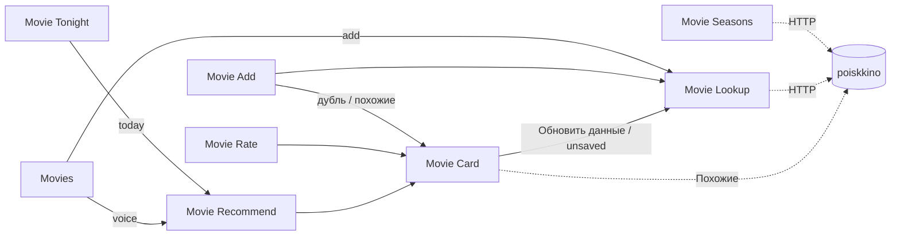

# Фильмы и сериалы

Личный список фильмов/сериалов в iPhone: добавляешь по названию, ставишь статус и оценку, получаешь рекомендации по своему вкусу и уведомления о новых сезонах. Данные — в Data Jar, метаданные — из poiskkino (Кинопоиск), распознавание названий и подбор — встроенный ИИ (Use Model, Private Cloud Compute).

**Основной способ — экран iPhone** (Add, Rate, Recommend, Stats, виджет). **Siri — дополнительно**: шорткат Movies умеет голосом добавить тайтл и подсказать, что посмотреть.

## Шорткаты

| Шорткат | Назначение | Тип |
|---|---|---|
| [Movie Lookup](lookup/README.md) | найти тайтл по запросу, вернуть запись (не сохраняет) | суб-шорткат |
| [Movie Card](card/README.md) | карточка тайтла: оценка + отзыв, статус, теги, чат с ИИ, ссылки, похожие, удаление | суб-шорткат |
| [Movie Add](add/README.md) | добавить тайтл в список | основной |
| [Movie Rate](rate/README.md) | просмотр списка по статусу, открыть карточку | основной |
| [Movie Recommend](recommend/README.md) | что посмотреть: по вкусу, случайно, по настроению, новое | основной |
| [Movie Tonight](tonight/README.md) | обёртка Recommend для виджета: один тайтл на вечер | виджет |
| [Movies](voice/README.md) | доп. вход для Siri: «add …» / «what to watch» одной фразой, ответ вслух | Siri (доп.) |
| [Movie Stats](stats/README.md) | статистика + разбор вкуса ИИ (чат) | основной |
| [Movie Seasons](seasons/README.md) | проверка новых сезонов раз в неделю | автоматизация |

Схема данных: [data.md](data.md).

Что ещё умеет:

- В карточке и превью Add — актёры, постер и трейлер (поиск на YouTube).
- У сериала — статус «Идёт / Завершён / Отменён» и дата ближайшей серии или сезона.
- Будущая премьера: только «Не смотрел» / «Скрыт» (без «Смотрю», «Смотрел», «Бросил», оценки); в рекомендации не попадает.
- Новый сезон у сериала со статусом «Смотрел» → Movie Seasons переводит его в «Смотрю».

## Граф вызовов

## Установка

1. Установить **Data Jar** из App Store. Других приложений не нужно.
2. Получить ключ poiskkino: Telegram-бот **@poiskkinodev_bot** → выдаёт ключ. Демо — 200 запросов/сутки (хватает: добавление ≈ 2 запроса).
3. В Data Jar создать **один** ключ верхнего уровня `movies` (Dictionary) — [структура](data.md#корень-movies). Внутри:
   - `settings` (Dictionary) по образцу из [data.md](data.md#moviessettings): вписать ключ API, `weights`, `top_n`, `ai_enabled`, `tags`, `genres`, `genre_map`, `type_map`, `type_labels`, `type_labels_en`;
   - `items` — пустой Dictionary.
4. Собрать шорткаты — по [порядку сборки](#порядок-сборки-и-проверки) (суб-шорткаты раньше тех, кто их вызывает через Run Shortcut).
5. Имена шорткатов — точно как в таблице (Run Shortcut ищет по имени).
6. Use Model: при первом запуске разрешить доступ к Apple Intelligence; модель — Private Cloud Compute.

## Порядок сборки и проверки

Каждый шаг — собрать → проверить → дальше.

### 1. Мини-тесты iOS (до сборки)

Крошечные тестовые шорткаты — от них зависит, верна ли дока. Пройдены на iPhone 2026-10-24 (iOS 27.0.1):

| # | Тест | Результат |
|---|---|---|
| 1 | **Use Model**, Output: Dictionary — попросить `{"a": 1}` | ✅ приходит словарь |
| 2 | **Use Model**, Follow Up | ✅ открывается чат |
| 3 | **Show Web Page** с любой ссылкой | ✅ Safari View внутри; после закрытия шорткат продолжается |
| 4 | **Stop This Shortcut** внутри вызванного через Run Shortcut | ✅ останавливается только дочерний; вызвавший продолжает с пустым результатом |
| 5 | **Get Contents of URL** к poiskkino с `X-API-KEY` | ✅ `docs` пришли |
| 6 | Data Jar: путь `test.items.kp-123.x` (3 уровня) | ✅ запись и чтение работают |
| 7 | Siri с **заблокированного** iPhone: «Ask for Input → Use Model → Data Jar Get Value → Stop and Output» | ❌ Siri не реагирует — голосовой путь только на разблокированном iPhone |

Следствие п. 4: каждый вызывающий шорткат проверяет пустой результат Run Shortcut (Lookup, Card, Recommend могут остановиться на проверке настроек).

Что-то не так → сначала поправить доку, потом собирать.

### 2. Сборка

На Mac: `movies/build.sh [шорткат]` (например `movies/build.sh rate`) — подпись и импорт в `movies/build/`; суб-шорткаты идут первыми.

| # | Шорткат | Проверить |
|---|---|---|
| 1 | Movie Lookup | «дюна пророчество», запрос с опечаткой, свежий фильм, вход `{kinopoisk_id}`, неверный ключ → уведомление 401, `ai_enabled: false` |
| 2 | Movie Card | вход `{record, saved:false}` из Lookup → «Добавить в список» → запись в Data Jar; затем оценка + отзыв, статус, ссылки, постер, похожие, «Спросить ИИ», «Обновить», удаление |
| 3 | Movie Add | превью «Это он?», дубль, «Смотрел» + оценка 8 → похожие, премьера в календарь |
| 4 | Movie Rate | все фильтры, пустой фильтр и «← К фильтрам» → меню, карточка и возврат |
| 5 | Movie Recommend | сначала «Мой список» и «Случайный», затем «Настроение» (уточнения, «↻ Не то»), затем «Новое» |
| 6 | Movie Tonight + виджет | тап → сразу карточка |
| 7 | Movie Stats | отчёт, «Разбор вкуса» |
| 8 | Movie Seasons + автоматизация | ручной запуск на одном сериале: первый раз заполняет `seasons_count`; неверный ключ → одно уведомление |
| 9 | Movies (голос) | «Hey Siri, Movies» с разблокированного iPhone и в AirPods: «add Dune Prophecy», русское название голосом, дубль, «something light for tonight» |

### 3. Наполнение

Добавить 10–15 тайтлов с оценками. С `min_ratings` (3) оценок «Мой список» начинает учитывать вкус, а не только внешние рейтинги.

## Виджет

Главный экран → долгое нажатие → Edit → Add Widget → Shortcuts → выбрать размер → в настройках виджета указать **Movie Tonight** (и при желании Movie Add в папке). Тап — сразу карточка одного тайтла на вечер.

## Автоматизация

Shortcuts → Automation → New Automation → **Time of Day** → воскресенье 19:00, Weekly → **Run Immediately** → действие Run Shortcut «Movie Seasons». Подробно — [seasons/README.md](seasons/README.md).

## Siri

«Hey Siri, **Movies**» → голосовой вход: добавить или что посмотреть, ответ вслух, без экрана — [voice/README.md](voice/README.md). Остальные шорткаты тоже запускаются по имени («Hey Siri, Movie Add»), но рассчитаны на экран. Apple Watch не поддерживается (нет Use Model на watchOS).
