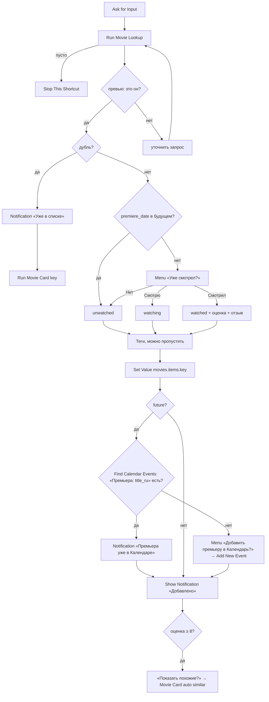

# Movie Add

## Назначение

Добавить фильм/сериал в список: запрос текстом или голосом → поиск (Movie Lookup) → проверка дублей → статус и оценка (премьера впереди → сразу «Не смотрел») → теги → сохранение → (если премьера впереди и события ещё нет) событие в Календаре.

## Вход / Выход

Вход: нет (или Text из Share Sheet / Siri — тогда пропустить Ask for Input). Выход: нет. Уведомление «Добавлено: …».

## Схема

## Шаги

Плоский список действий для сборки в редакторе — [actions.md](actions.md). Экспорт собранного шортката — [shortcut.xml](shortcut.xml).

1. **Get Value** `movies.settings` → `settings`. Пусто → **Show Notification** «Нет movies.settings — см. README, Установка» → **Stop This Shortcut**. Из `settings` — `tags`, `type_labels`.
   **If** Shortcut Input has any value → Set Variable `query` = Shortcut Input. Otherwise → **Ask for Input** (Text, «Что добавить?») → `query`. End If.
2. **Repeat** 5 раз (пока `ok` пуст) — поиск с превью:
   1. **Run Shortcut** Movie Lookup, Input = `query` → `rec`. Пусто → **Stop This Shortcut**.
   2. **Choose from Menu**, prompt — превью: `title_ru / title_en`, `year · тип · length мин`, `IMDb x · КП y`, `description`, источник (`ai` → «нет в poiskkino»). Пункты: **Да, это он** → `ok` = 1 · **Нет, искать другой** → **Ask for Input** «Уточни запрос (год, актёр, сериал/фильм)», Default = `query` → `query` · **Отмена** → **Stop This Shortcut**.
3. `ok` пуст после 5 попыток → **Stop This Shortcut**.
4. **Get Dictionary Value** `key` из `rec` → `key`.
5. Дубль по ключу: **Check If Value Exists** `movies.items.<key>` → **If** true → `dupKey` = `key`.
6. Дубль по названию (если `dupKey` пусто): **Get Value** `movies.items` → **Get Dictionary Value** All Values → **Repeat with Each**: **Change Case** lowercase `title_en` и `year` элемента == lowercase `rec.title_en` и `rec.year` → `dupKey` = `key` элемента. Ловит записи с другим ключом (`ai-` / `kp-` vs `tt…`).
7. **If** `dupKey` has any value → **Show Notification** «Уже в списке: title_ru» → **Run Shortcut** Movie Card, Input **Dictionary** `{key: dupKey}` → `res`; `res.action` = `similar` → список похожих, как в шаге 14 → **Stop This Shortcut**.
8. Премьера впереди: **If** `rec.premiere_date` has any value → **Get Dates from Input** → `pDate`; **If** `pDate` > Current Date → `future` = 1. **If** `future` = 1 → `status` = `unwatched` без вопроса. Otherwise → **Choose from Menu** «Уже смотрел?»:
   - **Нет** → **Set Dictionary Value** `status` = `unwatched` в `rec`.
   - **Смотрю** → `status` = `watching`.
   - **Смотрел** → `status` = `watched`; **Ask for Input** (Number, «Оценка 1–10»); If 1…10 → `my_rating`, иначе не задавать. `watched_date` = Current Date (Format Date ISO 8601). **Ask for Input** «Пара слов? (можно пусто)» → `note`.
9. Теги: **Choose from Menu** «Теги?» Добавить / Пропустить.
   - Добавить → **Choose from List** (Select Multiple) по `tags` из `movies.settings` (читаются в начале, вместе с настройками) → **Set Dictionary Value** `tags` в `rec`.
   - Пропустить → `tags` не ставить (пустое Set Dictionary Value не принимает, [data.md](../data.md#запись-moviesitemskey)).
10. **Set Dictionary Value** в `rec`: `origin` = `manual`, `added_date` = Current Date (ISO), `updated_date` = Current Date, `note` (если пусто — не добавлять), `my_rating` (если не задан — не добавлять), `watched_date` (если нет — не добавлять).
11. **Set Value** (Data Jar) `movies.items.<key>` = `rec`.
12. **If** `future` = 1 (шаг 8; `pDate` оттуда же):
    1. **Find Calendar Events** where Title is «Премьера: title_ru», Limit 1. **If** Calendar Events has any value → **Show Notification** «Премьера уже в Календаре», событие не добавлять. Otherwise:
    2. **Choose from Menu** «Добавить премьеру в Календарь?» Да / Нет.
    3. Да → **Add New Event**: Title «Премьера: title_ru», All Day on, Start Date = `pDate`, End Date = `pDate`.
13. **Show Notification** «Добавлено: title_ru (year) · статус», без `year` — «Добавлено: title_ru · статус» (статус — метка: Не смотрел / Смотрю / Смотрел).
14. **If** `my_rating` ≥ 8 → **Choose from Menu** «Показать похожие?» Да / Нет. Да → **Run Shortcut** Movie Card `{key, auto: "similar"}` → `res`. `res.action` = `similar` → список похожих → выбор → Movie Card `{record: item, saved: false}`; «Назад» из карточки → снова список, выход — «← Назад» в списке (`Repeat 20` + `simDone`, как в [Rate](../rate/README.md#шаги), шаг 9).

## Промпты ИИ

Нет (ИИ работает внутри Movie Lookup).

## Data Jar

Читает: `movies.items` (дубли), `movies.settings` (`tags`, `type_labels`). Пишет: `movies.items.<key>` целиком.

## Расход запросов poiskkino

Только через Movie Lookup: ~2 на попытку (до 4); каждое «Нет, искать другой» — ещё попытка. Дубль → 0 дополнительных. «Похожие» — +1.

## Заметки / ограничения

- Siri: «Movie Add» → Siri спросит текст голосом (Ask for Input работает с голосом).
- Можно добавить в Share Sheet (Receive Text/URLs) — тогда текст из шаринга сразу идёт в Lookup.
- Проверка дубля по названию — Repeat по всей базе; на сотнях записей — пара секунд.
- Отмена Choose from List прерывает весь шорткат — поэтому теги за отдельным меню «Да / Пропустить».
