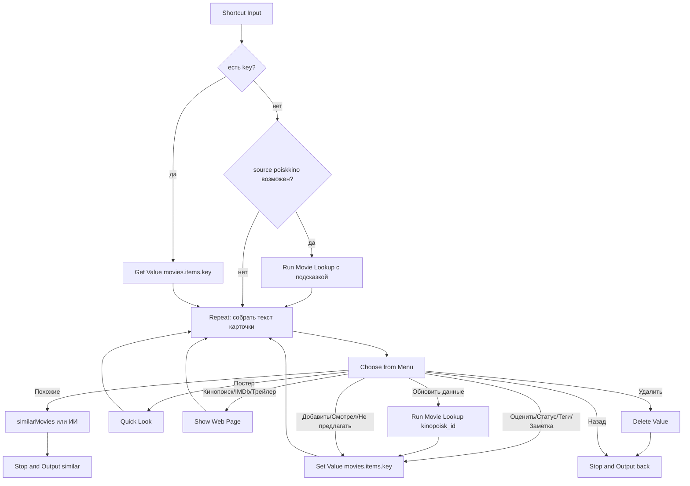

# Movie Card

## Назначение

Суб-шорткат: карточка одного тайтла и хаб действий — оценка, статус, теги, заметка, ссылки, постер, похожие, поделиться, обновление данных, удаление. Работает для сохранённой записи и для несохранённой (рекомендация ИИ / похожие).

## Вход / Выход

| Вход | Режим |
|---|---|
| `{key}` | сохранённая запись: читается `movies.items.<key>` |
| `{record, saved: false, predicted?}` | несохранённая; `predicted` — прогноз балла из Recommend (необязательно) |
| `{key, predicted}` | сохранённая + прогноз (из «Мой список») |
| `{key, auto: "similar"}` | сразу выполнить «Похожие» без меню (из Movie Add после высокой оценки) |

Выход (Stop and Output):

| Выход | Когда |
|---|---|
| `{action: "back"}` | «Назад», отмена, после «Удалить» |
| `{action: "similar", items: [light records]}` | «Похожие» — вызывающий показывает список |

Light record: `{title_en, title_ru, year, type, genres, kinopoisk_id?, ratings?}`.

## Схема



## Шаги

Плоский список действий для сборки в редакторе — [actions.md](actions.md).

### Загрузка

1. **Get Value** `movies.settings` → `settings`; `apiKey`, `tagsList` (`tags`), `genreList` (`genres` → **Combine Text** через `, `), `typeLabels` (`type_labels`), `typeMap` (`type_map`), `aiOn` (`ai_enabled`). [Проверка настроек](../data.md#ошибки).
2. **Get Dictionary Value** `key` из Shortcut Input → `key`. **Get Dictionary Value** `predicted` → `predicted`.
3. **If** `key` has any value → **Get Value** `movies.items.<key>` → `rec`; **Set Variable** `saved` = `yes`. `rec` пуст (запись удалили) → **Show Notification** «Запись не найдена» → **Stop and Output** `{action:"back"}`.
4. Otherwise → `rec` = `record` из входа; `saved` = `no`.
   - **If** `rec.source` ≠ `poiskkino` (light records из «Похожие» и ИИ-рекомендации поля `source` не имеют): **Dictionary** `{kinopoisk_id}` (если есть) иначе `{title_en, title_ru, year, type}` → **Run Shortcut** Movie Lookup → если результат есть → `rec` = результат. Это ленивое обогащение: запросы тратятся только при открытии карточки.
   - После обогащения: если ключ `rec.key` уже есть в `movies.items` (**Check If Value Exists** `movies.items.<rec.key>`) → `key` = `rec.key`, `rec` = Get Value, `saved` = `yes` (тайтл уже в базе).

### Цикл

5. **Repeat** 50 раз (выход — Stop and Output):
   1. Собрать **Text** карточки (пустые строки опускать через If):
      ```
      title_ru / title_en
      year · <Get Dictionary Value `type` из `typeLabels`> · length мин · age_rating+
      genres (через запятую)
      IMDb x · КП y · мой балл z | прогноз p
      Статус: <метка status>
      Теги: tags
      Заметка: note
      description
      ```
      Метки — из таблиц [data.md](../data.md#перечисления) через **Dictionary** + **Get Dictionary Value**. `мой балл` — если `my_rating`; `прогноз` — если передан `predicted`.
   2. **If** `saved` = `yes` → **Choose from Menu** (prompt = Text карточки) с пунктами:
      Оценить · Статус · Теги · Заметка · Спросить ИИ · Кинопоиск · IMDb · Трейлер · Постер · Похожие · Поделиться · Обновить данные · В календарь · Удалить · Назад.
      Пункт «В календарь» имеет смысл только при будущей премьере: внутри пункта **If** Get Dates from Input `premiere_date` > Current Date, иначе **Show Notification** «Премьера уже была» (Choose from Menu не умеет скрывать пункты динамически).
   3. Otherwise → **Choose from Menu**: Добавить в список · Смотрел + оценка · Не предлагать · Спросить ИИ · Кинопоиск · IMDb · Трейлер · Постер · Похожие · Поделиться · Назад.

   Перед циклом: вход `auto` = `similar` → сразу раздел [Похожие](#похожие), без меню.

### Действия (сохранённая)

После любого **Set Value** — **Get Value** `movies.items.<key>` → `rec`, чтобы следующий оборот цикла показал свежие данные.

| Пункт | Действия |
|---|---|
| Оценить | **Ask for Input** (Number, «Оценка 1–10»); If <1 или >10 → Show Notification «1–10», ничего не сохранять. Иначе **Set Value** `movies.items.<key>.my_rating`, `movies.items.<key>.status` = `watched`, `movies.items.<key>.watched_date` = Current Date (ISO), `movies.items.<key>.updated_date` → [после оценки](#после-оценки). |
| Статус | **Choose from Menu** Не смотрел / Смотрю / Смотрел / Бросил / Не предлагать → **Set Value** `movies.items.<key>.status` + `updated_date`. «Смотрел» → ещё `watched_date` = Current Date (если пусто); без `my_rating` → предложить Оценить (те же шаги). |
| Теги | **Choose from List** `tagsList`, Select Multiple, pre-selection невозможна → в prompt показать текущие теги. Результат (или пусто) → **Set Value** `movies.items.<key>.tags`. |
| Заметка | **Ask for Input** Text, Default Answer = `note` → **Set Value** `movies.items.<key>.note`. |
| Спросить ИИ | `aiOn` = `false` → «ИИ выключен». Иначе **Ask for Input** «Что спросить?» → **Use Model** (Private Cloud Compute, Output: Text, **Follow Up** on) — промпт «Спросить ИИ». Follow Up открывает чат: можно задавать вопросы дальше; закрыл — снова карточка. |
| Кинопоиск | If `kinopoisk_id` → **Show Web Page** `https://www.kinopoisk.ru/film/<kinopoisk_id>/`. Иначе Show Notification «Нет id Кинопоиска». |
| IMDb | If `imdb_id` → **Show Web Page** `https://www.imdb.com/title/<imdb_id>/`. Иначе Show Notification «Нет IMDb id». |
| Трейлер | **Text** `title_en year trailer` → **URL Encode** → **Show Web Page** `https://www.youtube.com/results?search_query=<encoded>`. |
| Постер | If `poster_url` → **Quick Look** `poster_url` (через **Get Contents of URL** → Quick Look, чтобы показать картинку). |
| Похожие | см. ниже. |
| Поделиться | **Text**: `title_ru / title_en (year)`, `IMDb x · КП y`, ссылки Кинопоиск/IMDb → **Share**. |
| Обновить данные | If `kinopoisk_id` → **Dictionary** `{kinopoisk_id}`, иначе `{title_en,title_ru,year,type}` → **Run Shortcut** Movie Lookup → результат пуст (отмена / API недоступно) → ничего не писать. Есть → **Set Value** в `movies.items.<key>` все **непустые** поля результата (пустое не затирает старое, напр. `seasons_count`), **кроме** пользовательских ([data.md](../data.md#запись-moviesitemskey)) и `key`: `title_en`, `title_ru`, `year`, `type`, `genres`, `imdb_id`, `kinopoisk_id`, `ratings`, `length`, `age_rating`, `premiere_date`, `seasons_count`, `release_status`, `description`, `poster_url`, `source`, `updated_date`. Show Notification «Обновлено». |
| В календарь | If **Get Dates from Input** `premiere_date` > Current Date → **Add New Event**: All Day, Start/End = `premiere_date`, Title «Премьера: title_ru», календарь по умолчанию. |
| Удалить | **Choose from Menu** «Удалить title_ru?» Да / Нет. Да → **Delete Value** `movies.items.<key>` → **Stop and Output** `{action:"back"}`. |
| Назад | **Stop and Output** **Dictionary** `{action: "back"}`. |

### Действия (несохранённая)

Общее для сохранения: ключ = `rec.key` (Lookup его уже собрал; если нет — по правилу [data.md](../data.md#ключ-записи)). Дописать `added_date`, `updated_date` = Current Date, `origin` = `recommendation`, `tags` = [], `note` = "". **Set Value** `movies.items.<key>` = `rec`. После сохранения: `saved` = `yes`, `key` = ключ — карточка дальше работает как сохранённая.

| Пункт | Статус |
|---|---|
| Добавить в список | `unwatched` |
| Смотрел + оценка | **Ask for Input** Number 1–10 (проверка как в «Оценить»; вне 1–10 → не сохранять) → `my_rating`, `status` = `watched`, `watched_date` → после сохранения [после оценки](#после-оценки) |
| Не предлагать | `dismissed` → Show Notification «Больше не предложу» → Stop and Output `{action:"back"}` |

Спросить ИИ, ссылки, Постер, Похожие, Поделиться, Назад — как у сохранённой.

### После оценки

Общее для «Оценить», «Статус → Смотрел → оценка», «Смотрел + оценка»:

1. **Ask for Input** «Пара слов? (можно пусто)». Не пусто → `note` пуст ? отзыв : `note · отзыв` → **Set Value** `movies.items.<key>.note`. Отзывы видит ИИ в «Новое» и «По настроению».
2. **If** `my_rating` ≥ 8 → **Choose from Menu** «Показать похожие?» Да / Нет. Да → раздел [Похожие](#похожие).

### Похожие

1. **If** `kinopoisk_id` → **Get Contents of URL** `https://api.poiskkino.dev/v1.5/movie/<kinopoisk_id>` (`X-API-KEY`) → `similarMovies`. **Repeat with Each** → **Dictionary** light record: `kinopoisk_id` = `id`, `title_ru` = `name`, `title_en` = `alternativeName` (`enName` в similarMovies нет), `year` (бывает пропущен), `type` = Get Dictionary Value (`type` из Repeat Item) из `typeMap`, пусто → `movie` ([data.md](../data.md#type)), `ratings` `{kp}` из `rating`, Round 0.1 (imdb в similarMovies нет; 0 → null), `genres` = [] → **Add to Variable** `items`.
1a. Ответ без `id` (ошибка API) → **Show Notification** `poiskkino: <statusCode> <message>`.
2. **If** `items` пусто (нет id, similarMovies пуст или API недоступно) **и** `aiOn` ≠ `false` → **Use Model** промпт «Похожие» ([с запасным путём](../data.md#ответ-ии-use-model)) → `items` = `similar`. ИИ не ответил → `items` пуст.
3. Исключить: **Repeat with Each** записей `movies.items` (Get Value `movies.items` → Get Dictionary Value All Values) с `status` ∈ watched/dropped/dismissed → собрать список `title_en lowercase + year` и `kinopoisk_id` → item, совпавший по любому из них, отбросить.
4. Пусто → Show Notification «Похожих нет» → продолжить цикл. Иначе **Stop and Output** `{action: "similar", items}`.

Показ похожих делает вызывающий (Rate, Recommend): список → выбор → Movie Card `{record: item, saved: false}`.

## Промпты ИИ

Похожие (Use Model, Private Cloud Compute, Output: Dictionary). Вставки: `[title_en]`, `[year]`, `[type]`, `[genres]`, `[genreList]`.

```
Suggest 5 movies or TV series similar to "[title_en]" ([year], [type], genres: [genres]).
Prefer titles similar in tone, themes and style, not just genre.

Return a dictionary with key "similar": a list of exactly 5 dictionaries, each with:
- "title_en": official English title (string)
- "title_ru": official Russian release title (string)
- "year": release year (number)
- "type": exactly one of: movie, tv_show, animation, animated_series, anime, documentary
- "genres": list of 1 to 4 genres, chosen ONLY from this list: [genreList]

Do not include "[title_en]" itself. Only real, existing titles.
```

Спросить ИИ (Use Model, Output: Text, Follow Up on). Вставки: поля записи, `[favorites]` — до 10 записей базы с `my_rating` ≥ 8: `title_en (year) — my_rating — note`, `[question]` — ввод.

```
You are a friendly movie expert. Answer in Russian, briefly and to the point.
Title: [title_en] / [title_ru] ([year], [type]). Genres: [genres].
Description: [description]
The user's ratings and comments for titles they liked:
[favorites]
Never reveal plot spoilers unless the user explicitly asks for them.
User question: [question]
```

## Data Jar

Читает: `movies.settings`, `movies.items.<key>`, `movies.items` (для исключений в «Похожие» и `[favorites]`).
Пишет: `movies.items.<key>.my_rating`, `.status`, `.watched_date`, `.tags`, `.note`, `.updated_date`, поля из «Обновить данные»; `movies.items.<key>` целиком при сохранении несохранённой; Delete Value `movies.items.<key>`.

## Расход запросов poiskkino

| Действие | Запросов |
|---|---|
| открыть сохранённую | 0 |
| открыть несохранённую (ленивый Lookup) | 1–2 (с `kinopoisk_id` — 1) |
| Обновить данные | 1 (без `kinopoisk_id` — ~2) |
| Похожие | 1 (ИИ-fallback — 0) |

## Заметки / ограничения

- Ссылки — **Show Web Page** (встроенный Safari): Done → снова карточка. Open URLs не использовать.
- Choose from Menu не скрывает пункты по условию — неприменимые пункты внутри проверяют условие и показывают уведомление.
- Repeat 50 — защита от бесконечного цикла (в Shortcuts нет while).
- Постер через Quick Look по URL: если не открывается — сначала Get Contents of URL (скачать картинку), потом Quick Look.
- Все записи изменять точечными путями `movies.items.<key>.<field>`, чтобы не затереть параллельные изменения.
