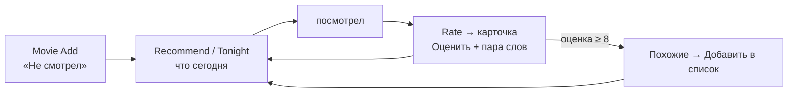

# Как пользоваться

Короткая памятка по шорткатам фильмов. Установка — [README.md](README.md#установка), поля записи — [data.md](data.md).

## Что запускать

| Хочу | Шорткат | Где |
|---|---|---|
| добавить фильм/сериал | **Movie Add** | экран, Share Sheet, «Hey Siri, Movie Add» |
| посмотреть список, оценить, поменять статус | **Movie Rate** | экран |
| выбрать, что посмотреть | **Movie Recommend** | экран |
| один тайтл на вечер без вопросов | **Movie Tonight** | виджет |
| статистика и разбор вкуса | **Movie Stats** | экран |
| добавить / спросить голосом | **Movies** | Siri, телефон разблокирован |
| синхронизировать с ТВ прямо сейчас | **Movie Rate** → «Синхронизировать» | экран |

Movie Lookup, Movie Card и Movie Sync вручную не запускать — их вызывают остальные.

## Обычный цикл

1. **Добавил.** Movie Add → название (можно с опечаткой, по-русски или по-английски) → превью «Да, это он» / «Нет, искать другой» → «Уже смотрел?» → теги или «Пропустить». Будущая премьера — сразу «Не смотрел» и предложение добавить «Премьера: …» в Календарь.
2. **Выбрал.** Movie Recommend или виджет Movie Tonight.
3. **Посмотрел → оценил.** Movie Rate → «Несмотренные» / «Смотрю» → тайтл → «Оценить» → 1–10 → «Пара слов?». Отзыв не пропускать: его читает ИИ в «По настроению», «Новое», «Спросить ИИ».
4. **Понравилось (8+)** → «Показать похожие?» → «Да» → выбрать → «Добавить в список».

## Movie Recommend

| Режим | Когда | Нужен ИИ |
|---|---|---|
| Мой список (по вкусу) | топ-3 из своего списка по оценкам и рейтингам | нет |
| Случайный | не хочется выбирать | нет |
| По настроению (ИИ) | «что-то лёгкое на час» — подберёт из своего списка, задаст 1–2 уточнения | да |
| Новое (ИИ) | своего списка мало — 5 тайтлов вне базы по твоему вкусу | да |

- «Фильтры» → «Настроить»: тип, жанры, длительность, тег. Ничего не выбрал = любой.
- «↻ Не то…» — написать, что не так («слишком старое»), ИИ подберёт заново с учётом.
- «← Назад» в списке — в меню. Cancel закрывает весь шорткат.
- «Мой список» начинает учитывать вкус от 3 оценок; до этого — только IMDb/КП.

## Карточка (Movie Card)

Открывается из Rate, Recommend, Add (дубль). Всё действие с тайтлом — здесь.

| Пункт | Зачем |
|---|---|
| Оценить | 1–10 + отзыв; ставит «Смотрел» |
| Статус | Не смотрел / Смотрю / Смотрел / Бросил / Не предлагать |
| Уведомления: вкл / выкл | только сериал: присылать ли в Telegram новые серии (флаг общий с ТВ) |
| Теги / Заметка | свои метки (список тегов — в `movies.settings.tags`) и заметка |
| Спросить ИИ | чат про тайтл без спойлеров («стоит ли с детьми?») |
| Кинопоиск / IMDb / Трейлер | встроенный Safari, Done — назад в карточку |
| Постер | картинка |
| Похожие | 5 похожих, без уже посмотренного |
| Поделиться | текст + ссылки |
| Обновить данные | освежить рейтинги/описание; оценки и статус не трогает |
| В календарь | событие «Премьера: …», если премьера впереди |
| Удалить | насовсем из базы (и из облака — метка удаления) |

Карточка тайтла **не из базы** (похожие, «Новое»): «Добавить в список» · «Смотрел + оценка» · «Не предлагать».

- «Не предлагать» — убрать из рекомендаций и похожих. Вернуть: Rate → «Скрытые» → Статус.
- «Бросил» — тоже сигнал вкуса (учитывается в «Новое» как «не понравилось»).

## Виджет

Главный экран → долгое нажатие → Edit → Add Widget → Shortcuts → в настройках виджета **Movie Tonight** (можно папку с Movie Add). Тап → сразу карточка одного тайтла из «Не смотрел»/«Смотрю». «Назад» — закрыть.

## Siri

Только «Hey Siri, **Movies**», iPhone **разблокирован** (с заблокированного не работает), Siri на английском.

- «add Dune Prophecy», «add the series Severance» → «Added: …». Русские названия — лучше по-английски, транскрипцию («brat two») ИИ понимает через раз.
- «what to watch tonight», «something light, a movie» → «Try: 1. … 2. … 3. …» из своего списка.
- Оценки, статусы, карточка — только на экране. Голосом добавленное открыть: Rate → «Несмотренные».

## Синхронизация с ТВ

Включается в Data Jar: `movies.settings.sync_enabled` = `true`, `sync_url`, `sync_key` ([data.md](data.md#moviessettings)). Выключена — всё работает только в iPhone, без запросов.

- Любая правка (оценка, статус, теги, заметка, «Уведомления», удаление, добавление) сразу уходит в облако. Нет сети — копится в очереди и уйдёт при следующей связи.
- Изменения с ТВ подтягиваются раз в день при запуске Rate, Recommend, Stats, Add или карточки. Сразу — Rate → «Синхронизировать».
- В карточке сериала — «Остановился: S2E5»: последняя серия, отмеченная на ТВ.
- Тайтлы, добавленные на ТВ, могут быть почти пустыми (название и статус) — «Обновить данные» в карточке дотянет описание, рейтинги, жанры.
- О новых сериях и сезонах теперь пишет бот в Telegram (сериалы с «Уведомления: вкл»). Movie Seasons больше нет — его автоматизацию в «Командах» удалить.

## Уведомления и что делать

| Уведомление | Значит | Что делать |
|---|---|---|
| Добавлено: … | сохранено | — |
| Уже в списке: … | дубль, открыта карточка | работать с ней |
| (нет в poiskkino) в превью | Кинопоиск не нашёл, данные от ИИ | уточнить запрос или сохранить и позже «Обновить данные» |
| Не найдено. Сохранить как есть? | ни ИИ, ни Кинопоиск не нашли | «Нет» и уточнить; «Да» — запись по названию, год и тип вручную |
| poiskkino: 401 … | неверный ключ | проверить `movies.settings.poiskkino_api_key` |
| poiskkino: <код> … (ключ верный) | лимит 200 запросов/сутки или сбой | подождать до завтра |
| Синхронизировано: тайтлов N, отметок серий M | ручная синхронизация прошла | — |
| Синхронизация выключена: movies.settings.sync_enabled | нажал «Синхронизировать» при выключенной | включить в Data Jar |
| Нет сети — правки в очереди | нет интернета | ничего: уйдут при следующей связи |
| Movie Sync: нет sync_url или sync_key в movies.settings | включено, но не настроено | вписать адрес и ключ |
| Movie Sync: отправка не удалась / изменения не получены — … | ответ воркера с ошибкой (`bad_key` — неверный ключ) | проверить `sync_key` / `sync_url`; очередь не потеряна |
| Нет movies.settings — см. README, Установка | Data Jar пуст или переименован корень | восстановить `movies.settings` по [data.md](data.md#moviessettings) |
| Нет ключа poiskkino в movies.settings | ключ пуст | вписать ключ |
| ИИ не ответил | Use Model не дал ответа | повторить; поиск при этом идёт по введённому тексту |
| ИИ выключен | `ai_enabled` = `false` | включить, когда Apple Intelligence доступна |
| Пусто / Ничего не подходит | нет тайтлов под фильтр | другой фильтр |
| Список пуст — добавь через Movie Add | нечего рекомендовать | добавить тайтлов |
| Похожих нет | всё похожее уже видел / не нашлось | — |
| Мало оценок | для «Разбора вкуса» нужно ≥ 3 | оценить ещё |
| Movies: «Nothing added. Check the phone for details.» | Lookup не нашёл / ошибка | посмотреть уведомление на телефоне |

Нет сети или упало системное действие — шорткат просто остановится с системной ошибкой, данные не портятся. Надолго нет Apple Intelligence — `movies.settings.ai_enabled` = `false`: поиск и «Мой список» работают без ИИ.

Проверка всего — [TESTING.md](TESTING.md).
