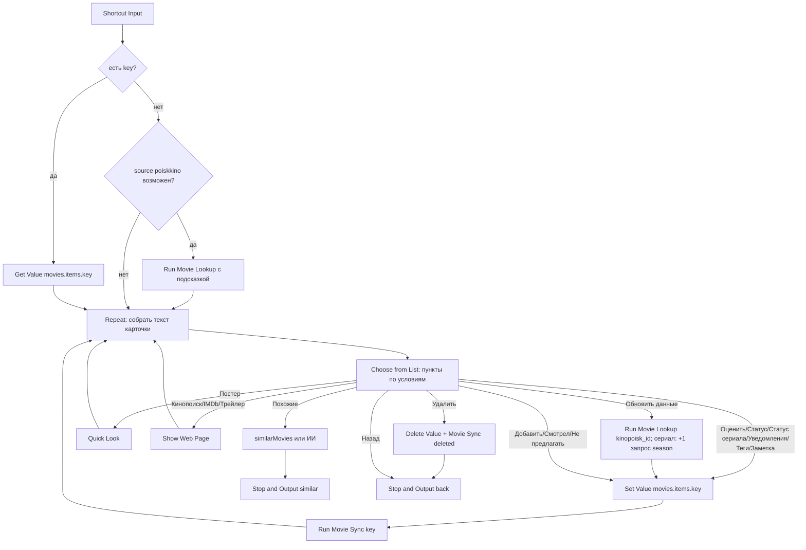

# Movie Card

## Назначение

Суб-шорткат: карточка одного тайтла и хаб действий — оценка, статус, статус сериала, уведомления о сериях, теги, заметка, ссылки, постер, похожие, поделиться, обновление данных, удаление. Работает для сохранённой записи и для несохранённой (рекомендация ИИ / похожие). Ключ записи может быть любым из [data.md](../data.md#ключ-записи), в том числе `tmdb-tv-…` / `tmdb-movie-…` с ТВ. Каждая правка уходит в облако через [Movie Sync](../sync/README.md).

## Вход / Выход

| Вход | Режим |
|---|---|
| `{key}` | сохранённая запись: читается `movies.items.<key>` |
| `{record, saved: false, predicted?}` | несохранённая; `predicted` — прогноз балла из Recommend (необязательно) |
| `{key, predicted}` | сохранённая + прогноз (из «Мой список») |
| `{key, auto: "similar"}` | сразу выполнить «Похожие» без меню (из Movie Add после высокой оценки) |

Выход (Stop and Output):

| Выход | Когда |
|---|---|
| `{action: "back"}` | «Назад», отмена, после «Удалить» |
| `{action: "similar", items: [light records]}` | «Похожие» — вызывающий показывает список |

Light record: `{title_en, title_ru, year, type, genres, kinopoisk_id?, ratings?}`.

## Схема



## Шаги

Плоский список действий для сборки в редакторе — [actions.md](actions.md). Экспорт собранного шортката — [shortcut.xml](shortcut.xml).

### Загрузка

1. **Get Value** `movies.settings` → `settings` ([проверка настроек](../data.md#ошибки)) → **Run Shortcut** [Movie Sync](../sync/README.md) с Text `auto` (раз в день забрать изменения из облака). Затем `apiKey`, `tagsList` (`tags`), `genreList` (`genres` → **Combine Text** через `, `), `typeLabels` (`type_labels`), `typeMap` (`type_map`), `aiOn` (`ai_enabled`).
2. **Get Dictionary Value** `key` из Shortcut Input → `key`. **Get Dictionary Value** `predicted` → `predicted`.
3. **If** `key` has any value → **Get Value** `movies.items.<key>` → `rec`; **Set Variable** `saved` = `yes`. `rec` пуст (запись удалили) → **Show Notification** «Запись не найдена» → **Stop and Output** `{action:"back"}`.
4. Otherwise → `rec` = `record` из входа; `saved` = `no`.
   - **If** `rec.source` ≠ `poiskkino` (light records из «Похожие» и ИИ-рекомендации поля `source` не имеют): **Dictionary** `{kinopoisk_id}` (если есть) иначе `{title_en, title_ru, year, type}` → **Run Shortcut** Movie Lookup → если результат есть → `rec` = результат. Это ленивое обогащение: запросы тратятся только при открытии карточки.
   - После обогащения: если ключ `rec.key` уже есть в `movies.items` (**Check If Value Exists** `movies.items.<rec.key>`) → `key` = `rec.key`, `rec` = Get Value, `saved` = `yes` (тайтл уже в базе).

### Цикл

5. **Repeat** 50 раз (выход — Stop and Output):
   1. Собрать **Text** карточки (пустые строки опускать через If):
      ```
      title_ru / title_en
      year · <Get Dictionary Value `type` из `typeLabels`> · length мин · age_rating+
      genres (через запятую)
      В ролях: actors (через запятую, до 5)
      IMDb x · КП y · мой балл z | прогноз p
      Статус: <метка status>
      Сериал: <Идёт | Завершён | Отменён>   — только сериал, метка release_status
      Следующая: next_episode               — только если поле есть
      Остановился: S2E5                     — только сериал; последняя просмотренная серия из movies.episodes.<key> (приходит синхронизацией с ТВ)
      Теги: tags
      Заметка: note
      description
      ```
      Метки — из таблиц [data.md](../data.md#перечисления) через **Dictionary** + **Get Dictionary Value**. `мой балл` — если `my_rating`; `прогноз` — если передан `predicted`.
   2. **Флаги** (до меню): `isFuture` = 1 при [будущей премьере](../data.md#status) (`premiere_date` > Current Date через Get Dates from Input; нет даты — 1 января года `year` > Current Date), `isSeries` = 1 для `tv_show` / `animated_series` / `anime`.
   3. **Меню** — **Choose from Menu** статичен и не умеет скрывать пункты, поэтому здесь **Choose from List** (prompt = Text карточки) по списку `menuItems`: неприменимые пункты в список не добавляются (If → Add to Variable). Выбранная метка → `act` через словарь `menuMap` (метка → код действия). Состав:
      - `saved` = `yes`: Оценить (нет при `isFuture`) · Статус · Статус сериала и «Уведомления: вкл / выкл» (только `isSeries`) · Теги · Заметка · Спросить ИИ · Кинопоиск · IMDb · Трейлер · Постер · Похожие · Поделиться · Обновить данные · В календарь (только при `isFuture`) · Удалить · Назад.
      - Otherwise: Добавить в список · Смотрел + оценка (нет при `isFuture`) · Не предлагать · Спросить ИИ · Кинопоиск · IMDb · Трейлер · Постер · Похожие · Поделиться · Назад.

   Перед циклом: вход `auto` = `similar` → сразу раздел [Похожие](#похожие), без меню.

### Действия (сохранённая)

В начале каждого оборота цикла (если `saved` = `yes`) — **Get Value** `movies.items.<key>` → `rec`, поэтому после любого **Set Value** карточка показывает свежие данные.

| Пункт | Действия |
|---|---|
| Оценить | **Ask for Input** (Number, «Оценка 1–10»); If <1 или >10 → Show Notification «1–10», ничего не сохранять. Иначе **Set Value** `movies.items.<key>.my_rating`, `movies.items.<key>.status` = `watched`, `movies.items.<key>.watched_date` = Current Date (ISO), `movies.items.<key>.updated_date` → [после оценки](#после-оценки). |
| Статус | **Choose from Menu** Не смотрел / Смотрю / Смотрел / Бросил / Не предлагать (при `isFuture` — отдельное меню только Не смотрел / Не предлагать) → **Set Value** `movies.items.<key>.status` + `updated_date`. «Смотрел» → ещё `watched_date` = Current Date (если пусто); без `my_rating` → **Choose from Menu** «Оценить сейчас?» Да / Нет; Да → Оценить (те же шаги). |
| Статус сериала | Только `isSeries`. **Choose from Menu** Идёт / Завершён / Отменён → **Set Value** `movies.items.<key>.release_status` (`ongoing` / `completed` / `cancelled`) + `updated_date` ([Release status](../data.md#release-status)). |
| Уведомления: вкл / выкл | Только `isSeries`. Метка показывает текущее `notify` (Boolean). Выбор переключает: **Dictionary** `{v: Boolean}` → **Get Dictionary Value** `v` → **Set Value** `movies.items.<key>.notify` + `updated_date`. По `notify` Cron воркера шлёт в Telegram новые серии ([data.md](../data.md#запись-moviesitemskey)). |
| Теги | **Choose from List** `tagsList`, Select Multiple, pre-selection невозможна → в prompt показать текущие теги. Результат есть → **Set Value** `movies.items.<key>.tags`; пусто → **Delete Value** `movies.items.<key>.tags`. |
| Заметка | **Ask for Input** Text, Default Answer = `note` → **Set Value** `movies.items.<key>.note`. |
| Спросить ИИ | `aiOn` = `false` → «ИИ выключен». Иначе **Ask for Input** «Что спросить?» → **Use Model** (Private Cloud Compute, Output: Text, **Follow Up** on) — промпт «Спросить ИИ». Follow Up открывает чат: можно задавать вопросы дальше; закрыл — снова карточка. |
| Кинопоиск | If `kinopoisk_id` → **Show Web Page** `https://www.kinopoisk.ru/film/<kinopoisk_id>/`. Иначе Show Notification «Нет id Кинопоиска». |
| IMDb | If `imdb_id` → **Show Web Page** `https://www.imdb.com/title/<imdb_id>/`. Иначе Show Notification «Нет IMDb id». |
| Трейлер | **Text** `title_en year trailer` → **URL Encode** → **Show Web Page** `https://www.youtube.com/results?search_query=<encoded>`. |
| Постер | If `poster_url` → **Get Contents of URL** `poster_url` → **Quick Look** (картинка). Иначе Show Notification «Нет постера». |
| Похожие | см. ниже. |
| Поделиться | **Text**: `title_ru / title_en (year)`, `IMDb x · КП y`, ссылки Кинопоиск/IMDb → **Share**. |
| Обновить данные | If `kinopoisk_id` → **Dictionary** `{kinopoisk_id}`, иначе `{title_en,title_ru,year,type}` (нет `title_en` — у записей с ТВ — вместо него `title_ru`: поиск poiskkino по названию и году) → **Run Shortcut** Movie Lookup → результат пуст (отмена / API недоступно) → ничего не писать. Есть → ключ записи не меняется (`tmdb-…`, `kp-`, `ai-` остаются, найденный `imdb_id` пишется полем) → **Set Value** в `movies.items.<key>` все **непустые** поля результата (пустое не затирает старое, напр. `seasons_count`), **кроме** пользовательских ([data.md](../data.md#запись-moviesitemskey)) и `key`: `title_en`, `title_ru`, `year`, `type`, `genres`, `imdb_id`, `kinopoisk_id`, `ratings`, `length`, `age_rating`, `premiere_date`, `seasons_count`, `release_status`, `actors`, `description`, `poster_url`, `source`, `updated_date`. Если `release_status` был `cancelled` — вернуть `cancelled` после записи (поставлен вручную, [data.md](../data.md#release-status)). **Сериал** (по свежему `type`): ещё **Get Contents of URL** `https://api.poiskkino.dev/v1.5/season?movieId=<kinopoisk_id>&limit=50` (`X-API-KEY`, без `selectFields`) → нет `docs` → **Show Notification** `poiskkino: <statusCode> <message>`, поля сезонов не трогать; иначе `seasons_count` (макс. `number` > 0 среди сезонов с `airDate` ≤ сегодня; нет — старое не трогать) и `next_episode` (ближайшая будущая серия `S3E5 — 2026-11-12`, иначе будущий сезон `Сезон 4 — 2027-03-01`, иначе **Delete Value** поля) — [алгоритм](../data.md#сезоны-poiskkino--next_episode-seasons_count); даты сравниваются числом `yyyyMMdd` (`airDate` без времени). Show Notification «Обновлено». |
| В календарь | If **Get Dates from Input** `premiere_date` > Current Date → **Find Calendar Events** where Title is «Премьера: title_ru», Limit 1: есть → **Show Notification** «Премьера уже в Календаре»; нет → **Add New Event**: All Day, Start/End = `premiere_date`, Title «Премьера: title_ru», календарь по умолчанию. Премьера прошла → «Премьера уже была»; `premiere_date` пуст → «Нет даты премьеры». |
| Удалить | **Choose from Menu** «Удалить title_ru?» Да / Нет. Да → **Delete Value** `movies.items.<key>` → **Run Shortcut** Movie Sync `{key, deleted: true, record: rec}` (метка удаления в облако) → **Stop and Output** `{action:"back"}`. |
| Назад | **Stop and Output** **Dictionary** `{action: "back"}`. |

**Отправка в облако** (шаг 31a, до «Похожих», которые выходят через Stop and Output): если в обороте был пункт Оценить / Статус / Статус сериала / Уведомления / Теги / Заметка / Обновить данные или сохранена несохранённая запись (`saveStatus`) → **Run Shortcut** Movie Sync `{key}`. Movie Sync ставит `updated_ms`, кладёт запись в очередь и отправляет; без сети — тихо оставляет в очереди. «Не предлагать» у несохранённой выходит сразу — Movie Sync вызывается до уведомления.

### Действия (несохранённая)

Общее для сохранения: ключ = `rec.key` (Lookup его уже собрал; если нет — по правилу [data.md](../data.md#ключ-записи)). Дописать `added_date`, `updated_date` = Current Date, `origin` = `recommendation` (`tags` / `note` не ставить — пустые, [data.md](../data.md#запись-moviesitemskey)). **Set Value** `movies.items.<key>` = `rec`. После сохранения: `saved` = `yes`, `key` = ключ — карточка дальше работает как сохранённая.

| Пункт | Статус |
|---|---|
| Добавить в список | `unwatched` |
| Смотрел + оценка | **Ask for Input** Number 1–10 (проверка как в «Оценить»; вне 1–10 → не сохранять) → `my_rating`, `status` = `watched`, `watched_date` → после сохранения [после оценки](#после-оценки) |
| Не предлагать | `dismissed` → Show Notification «Больше не предложу» → Stop and Output `{action:"back"}` |

Спросить ИИ, ссылки, Постер, Похожие, Поделиться, Назад — как у сохранённой.

### После оценки

Общее для «Оценить», «Статус → Смотрел → оценка», «Смотрел + оценка»:

1. **Ask for Input** «Пара слов? (можно пусто)». Не пусто → `note` пуст ? отзыв : `note · отзыв` → **Set Value** `movies.items.<key>.note`. Отзывы видит ИИ в «Новое» и «По настроению».
2. **If** `my_rating` ≥ 8 → **Choose from Menu** «Показать похожие?» Да / Нет. Да → раздел [Похожие](#похожие).

### Похожие

1. **If** `kinopoisk_id` → **Get Contents of URL** `https://api.poiskkino.dev/v1.5/movie/<kinopoisk_id>` (`X-API-KEY`) → `similarMovies`. **Repeat with Each** → **Dictionary** light record: `kinopoisk_id` = `id`, `title_ru` = `name`, `title_en` = `alternativeName` (`enName` в similarMovies нет), `year` (бывает пропущен), `type` = Get Dictionary Value (`type` из Repeat Item) из `typeMap`, пусто → `movie` ([data.md](../data.md#type)), `ratings` `{kp}` из `rating`, Round 0.1 (imdb в similarMovies нет; 0 → null), `genres` не ставить, `ratings` — только если есть `kp` → **Add to Variable** `items`.
1a. Ответ без `id` (ошибка API) → **Show Notification** `poiskkino: <statusCode> <message>`.
2. **If** `items` пусто (нет id, similarMovies пуст или API недоступно) **и** `aiOn` ≠ `false` → **Use Model** промпт «Похожие» ([с запасным путём](../data.md#ответ-ии-use-model)) → `items` = `similar`. ИИ не ответил → **Show Notification** «ИИ не ответил», `items` пуст.
3. Исключить: **Repeat with Each** записей `movies.items` (Get Value `movies.items` → Get Dictionary Value All Values) с `status` ∈ watched/dropped/dismissed → собрать список `title_en lowercase + year` и `kinopoisk_id` → item, совпавший по любому из них, отбросить.
4. Пусто → Show Notification «Похожих нет» → продолжить цикл. Иначе **Stop and Output** `{action: "similar", items}`.

Показ похожих делает вызывающий (Rate, Recommend): список → выбор → Movie Card `{record: item, saved: false}`.

## Промпты ИИ

Похожие (Use Model, Private Cloud Compute, Output: Dictionary). Вставки: `[title_en]`, `[year]`, `[type]`, `[genres]`, `[genreList]`.

```
Suggest 5 movies or TV series similar to "[title_en]" ([year], [type], genres: [genres]).
Prefer titles similar in tone, themes and style, not just genre.

Return a dictionary with key "similar": a list of exactly 5 dictionaries, each with:
- "title_en": official English title (string)
- "title_ru": official Russian release title (string)
- "year": release year (number)
- "type": exactly one of: movie, tv_show, animation, animated_series, anime, documentary
- "genres": list of 1 to 4 genres, chosen ONLY from this list: [genreList]

Do not include "[title_en]" itself. Only real, existing titles.
```

Спросить ИИ (Use Model, Output: Text, Follow Up on). Вставки: поля записи, `[favorites]` — до 10 записей базы с `my_rating` ≥ 8: `title_en (year) — my_rating — note`, `[question]` — ввод.

```
You are a friendly movie expert. Answer in Russian, briefly and to the point.
Title: [title_en] / [title_ru] ([year], [type]). Genres: [genres].
Description: [description]
The user's ratings and comments for titles they liked:
[favorites]
Never reveal plot spoilers unless the user explicitly asks for them.
User question: [question]
```

## Data Jar

Читает: `movies.settings`, `movies.items.<key>`, `movies.items` (для исключений в «Похожие» и `[favorites]`), `movies.episodes.<key>` (строка «Остановился»).
Пишет: `movies.items.<key>.my_rating`, `.status`, `.release_status`, `.notify`, `.watched_date`, `.tags`, `.note`, `.updated_date`, поля из «Обновить данные» (+ `.seasons_count`, `.next_episode` у сериалов); `movies.items.<key>` целиком при сохранении несохранённой; Delete Value `movies.items.<key>`. Очередь и `updated_ms` пишет Movie Sync.

## Расход запросов poiskkino

| Действие | Запросов |
|---|---|
| открыть сохранённую | 0 |
| открыть несохранённую (ленивый Lookup) | 1–2 (с `kinopoisk_id` — 1) |
| Обновить данные | 1 (без `kinopoisk_id` — ~2); сериал: +1 (`/v1.5/season`) |
| Похожие | 1 (ИИ-fallback — 0) |

## Заметки / ограничения

- Ссылки — **Show Web Page** (встроенный Safari): Done → снова карточка. Open URLs не использовать.
- Choose from Menu не скрывает пункты по условию — главное меню собрано как Choose from List из `menuItems` (неприменимые не добавляются). Подменю (статусы, статус сериала, «Удалить?») — обычные Choose from Menu; меню статусов при будущей премьере — отдельная ветка If.
- Repeat 50 — защита от бесконечного цикла (в Shortcuts нет while).
- Постер через Quick Look по URL: если не открывается — сначала Get Contents of URL (скачать картинку), потом Quick Look.
- Все записи изменять точечными путями `movies.items.<key>.<field>`, чтобы не затереть параллельные изменения.
