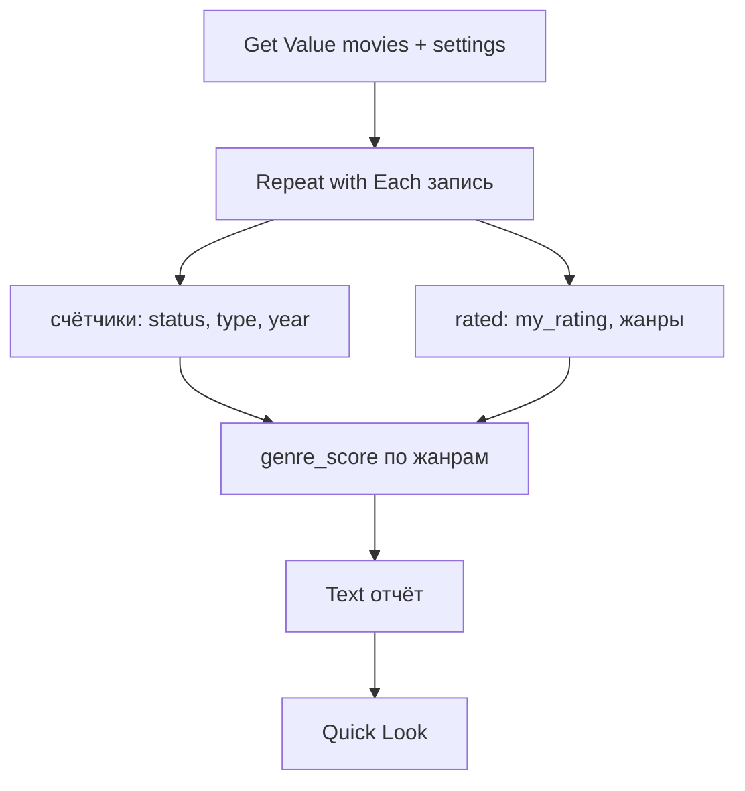

# Movie Stats

## Назначение

Сводка по базе: статусы, типы, оценки, любимые жанры, просмотры по годам, топ-5.

## Вход / Выход

Вход: нет. Выход: форматированный текст в **Quick Look** (или **Show Result**).

## Схема



## Шаги

Плоский список действий для сборки в редакторе — [actions.md](actions.md).

1. **Get Value** `movies.settings` → `settings` ([проверка настроек](../data.md#ошибки), ключ API не нужен) → `k` = `weights.smoothing_k` (пусто → 3), `aiOn` = `ai_enabled`. **Get Value** `movies.items` → пусто → **Show Notification** «База пуста» → **Stop This Shortcut**; иначе All Values → `db`.
2. Счётчики — **Dictionary** `byStatus`, `byType`, `byYear`, `gSum`, `gCnt` (пустые).
3. **Repeat with Each** `db`:
   1. `byStatus[status] += 1`, `byType[type] += 1` (Get Dictionary Value → **Calculate** +1, пусто = 0 → **Set Dictionary Value**).
   2. **If** `watched_date` → **Get Dates from Input** → **Format Date** `yyyy` → `byYear[год] += 1`.
   3. **If** `my_rating` → **Add to Variable** `ratings`; **Add to Variable** `rated` (запись); для каждого жанра `gSum[g] += my_rating`, `gCnt[g] += 1`.
4. `n` = Count `ratings`; `n` = 0 → в отчёте «Оценок нет», шаги 5–6 пропустить. Иначе `mean` = **Calculate Statistics** Average `ratings` → Round 0.1.
5. Жанры: **Repeat with Each** ключей `gCnt` → `genre_score = (gSum + k·mean) / (gCnt + k)` (та же формула, что в [Recommend](../recommend/README.md#скоринг-мой-список)) → Dictionary `gScore` genre → score → [топ без сортировки](../data.md#топ-без-сортировки), N = 5 → строка `Genre — 8.1 (gCnt)`.
6. Топ-5: Dictionary `key` → `my_rating` из `rated` → топ, N = 5 → `★ my_rating title_ru (year)`.
7. Годы: `minY` / `maxY` = **Calculate Statistics** Minimum / Maximum по ключам `byYear` → **Repeat** (`maxY − minY + 1`) раз, год = `minY + Repeat Index − 1` → есть в `byYear` → строка `год: N`.
8. Метки статусов — из [data.md](../data.md#status); типов — Get Dictionary Value `type` из `settings.type_labels`.
9. **Text** отчёт:
   ```
   Всего: N
   Статусы: Смотрел 42 · Смотрю 3 · Не смотрел 17 · Бросил 2 · Не предлагать 5
   Типы: Фильм 50 · Сериал 15 · …
   Оценено: n, средняя mean

   Любимые жанры:
   Drama — 7.9 (14)
   …

   Посмотрено по годам:
   2025: 31
   2026: 11

   Топ-5:
   ★10 …
   ```
10. **Quick Look** Text.
11. **Choose from Menu** «Дальше?»: Разбор вкуса (ИИ) / Готово.
12. Разбор вкуса: `aiOn` = `false` → «ИИ выключен». `n` < 3 → **Show Notification** «Мало оценок». Иначе **Use Model** (Private Cloud Compute, Output: Text, **Follow Up** on) — промпт «Разбор вкуса». Follow Up открывает чат — можно спрашивать дальше («что посмотреть из старого кино?»).

## Промпты ИИ

Разбор вкуса. Вставки: `[report]` — текст отчёта (шаг 9); `[top]` — топ-10 по `my_rating`: `title_en (year, type) — my_rating — note`; `[low]` — до 10 с `my_rating` ≤ 5 или `status` = `dropped`: то же.

```
You are a film critic analyzing one person's taste. Answer in Russian.

Their statistics:
[report]

Titles they rated highest, with their comments:
[top]

Titles they rated lowest or dropped, with their comments:
[low]

Describe their taste in 4 to 6 sentences: what they value, what they dislike, patterns by genre, type and era. Then suggest 3 directions to explore (genres, directors, countries or themes) that they have not tried much. No plot spoilers.
```

## Data Jar

Читает: `movies.items`, `movies.settings.weights`. Пишет: ничего.

Топ-10 и «низкие» для промпта — [топ без сортировки](../data.md#топ-без-сортировки).

## Расход запросов poiskkino

0.

## Заметки / ограничения

- Сортировки нет — топы перебором максимума ([data.md](../data.md#топ-без-сортировки)), годы — циклом от минимального к максимальному.
