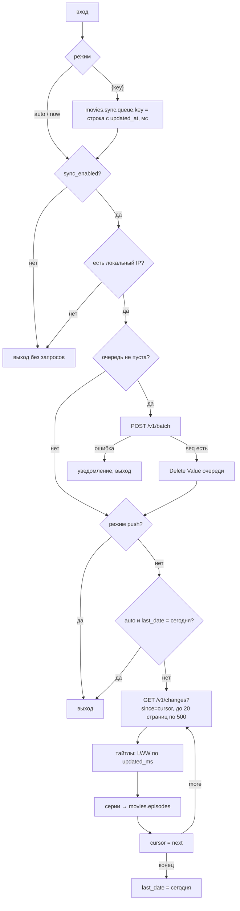

# Movie Sync

## Назначение

Суб-шорткат синхронизации Data Jar с облаком списка (воркер `cloud/list-worker`, общий с ТВ). Три работы:

- **Отправка правки**: каждая правка записи (статус, оценка, теги, заметка, `notify`, удаление, добавление, «Обновить данные») сначала ложится в очередь `movies.sync.queue`, затем очередь уходит `POST /v1/batch`. Нет сети — очередь ждёт следующей удачной связи.
- **Забор изменений** не чаще раза в день и только при обращении к данным: Rate, Recommend, Stats, Card, Add зовут Movie Sync в начале; если `movies.sync.last_date` ≠ сегодня — `GET /v1/changes` с курсора.
- **Вручную**: пункт «Синхронизировать» в меню Movie Rate — отправка очереди и забор изменений сразу, с итогом в уведомлении.

Синхронизация выключена (`movies.settings.sync_enabled` ≠ `true`) → ни одного запроса; правки продолжают копиться в очереди и уйдут после включения. Поля, ключи и сопоставление с облаком — [data.md](../data.md#синхронизация-с-облаком).

## Вход / Выход

| Вход | Режим |
|---|---|
| пусто / Text `auto` | очередь (если есть) → забор изменений, если сегодня ещё не было |
| Text `now` | очередь → забор изменений всегда; итог и причины отказа — уведомлением |
| Dictionary `{key}` | правка записи `movies.items.<key>` → очередь → отправка |
| Dictionary `{key, deleted: true, record}` | удаление: метка `deleted` со снимком `record` (запись в Data Jar уже стёрта) → очередь → отправка |

Выход: ничего. Вызывающий результат не читает. Stop This Shortcut внутри останавливает только Movie Sync ([мини-тест 4](../README.md#1-мини-тесты-ios-до-сборки)).

## Схема

## Шаги

Плоский список действий — [actions.md](actions.md).

1. **Get Value** `movies.settings` → `settings`. Пусто → **Stop This Shortcut** молча (вызывающий уже показал «Нет movies.settings»).
2. Режим: **Get Type** входа. Text `now` → `mode` = `now`; Dictionary → `push`; иначе `auto`.
3. `push`:
   1. `key` из входа; пусто → выход.
   2. Время правки в мс от 1970-01-01 UTC: **Text** `1970-01-01T00:00:00Z` → **Get Dates from Input** → **Get Time Between Dates** до Current Date в секундах → **Calculate** × 1000 → **Round Number** → `nowMs`. На ТВ то же время — `System.currentTimeMillis()`, поэтому LWW сравнивает одинаковые шкалы.
   3. Вход `deleted` = `true` → `rec` = `record` из входа (нет — `{key}`), строка `{key, updated_at: nowMs, deleted: true}`.
   4. Иначе: **Check If Value Exists** `movies.items.<key>` (нет — выход) → **Get Value** записи → **Set Value** `movies.items.<key>.updated_ms` = `nowMs` и то же поле в `rec` → строка `{key, updated_at: nowMs, deleted: false}`.
   5. **Set Dictionary Value** `data` = `rec` в строке → **Set Value** `movies.sync.queue.<key>`. Очередь — словарь по ключу: повторная правка того же тайтла заменяет строку (облаку нужна только последняя версия, LWW по всей записи).
4. **If** `settings.sync_enabled` (Boolean) не `true` → `now`: «Синхронизация выключена: movies.settings.sync_enabled» → выход. Нет `sync_url` или `sync_key` → «Movie Sync: нет sync_url или sync_key в movies.settings» → выход.
5. **Get Current IP Address** (Local, IPv4) пуст → `now`: «Нет сети — правки в очереди» → выход. Try/catch в Shortcuts нет: без этой проверки Get Contents of URL офлайн уронит и вызывающий шорткат.
6. Очередь: **Check If Value Exists** `movies.sync.queue` → **Get Value** → All Values → **Repeat with Each**: **Text** `[Repeat Item]` (словарь → JSON) → **Add to Variable** `parts` → **Combine Text** через `,` → **Text** `{"titles":[…]}` → **Get Contents of URL** `<sync_url>/v1/batch`, POST, заголовок `X-VG-List-Key: <sync_key>`, Request Body = File (`body`). Тело собирается текстом: Set Dictionary Value кладёт список из одного элемента не массивом ([data.md](../data.md#запись-moviesitemskey)), а воркер требует массив. Ответ — Dictionary с `seq` → **Delete Value** `movies.sync.queue`. Иначе → «Movie Sync: отправка не удалась — <ответ>» → выход (очередь остаётся).
7. `push` → выход.
8. Раз в день: **Format Date** Current Date `yyyy-MM-dd` → `today`. `movies.sync` есть → **Get Value** → `syncD`. `auto` и `syncD.last_date` = `today` → выход. `cursor` = `syncD.cursor`, нет — 0.
9. **Repeat** 20 (флаг `done`): **Get Contents of URL** `<sync_url>/v1/changes?since=<cursor>&limit=500` с заголовком → не Dictionary или нет `next` → «Movie Sync: изменения не получены — <ответ>» → выход. **Get Value** `movies.items` → `items`.
   1. **Repeat with Each** `titles`: `rT` = Number `updated_at`, `lT` = Number `updated_ms` локальной записи (нет записи или поля — 0). `rT` > `lT`: `deleted` = `true` → **Delete Value** `movies.items.<key>` (если была); иначе `data` + `updated_ms` = `rT` + `key` → **Set Value** `movies.items.<key>` (запись целиком, как LWW на ТВ).
   2. **Repeat with Each** `episodes`: `code` = `season × 10000 + episode`. `watched` = `true` и не `deleted` → **Set Value** `movies.episodes.<title_key>.c<code>` = `S<season>E<episode>`; иначе — **Delete Value** этого пути (если есть). Позиции (`positions`) iPhone не нужны — пропускаются.
   3. **Set Value** `movies.sync.cursor` = `next` (не `seq` ответа batch: так пропустились бы чужие правки). `more` ≠ `true` → `done` = 1.
10. `done` = 1 → **Set Value** `movies.sync.last_date` = `today` (не все страницы прочитаны — завтра продолжит с курсора, а «Синхронизировать» — сразу). `now` → «Синхронизировано: тайтлов N, отметок серий M».

## Промпты ИИ

Нет.

## Data Jar

Читает: `movies.settings` (`sync_enabled`, `sync_url`, `sync_key`), `movies.items`, `movies.sync`.
Пишет: `movies.items.<key>` (целиком из облака, `.updated_ms` при правке), Delete Value `movies.items.<key>` по метке удаления; `movies.sync.queue.<key>`, `movies.sync.cursor`, `movies.sync.last_date`, Delete Value `movies.sync.queue`; `movies.episodes.<key>.c<code>`.

## Запросы

Воркер списка, не poiskkino. Выключено — 0. Правка — 1 (`POST /v1/batch`, вся очередь одним запросом). Забор — 1 в день на страницу из 500 изменений (обычно 1), плюс отправка очереди, если она не пуста. Ключ `sync_key` — только в Data Jar, в шорткат и документацию не вписывать.

## Заметки / ограничения

- Проверено только как XML: на Mac не собиралось, на iPhone не запускалось. Что проверить — [TESTING.md](../TESTING.md#синхронизация-movie-sync).
- Предположения, которые подтверждает первый запуск: словарь в Text превращается в JSON (`true`/`false`, числа без кавычек); Get Dates from Input понимает `Z` (UTC) — иначе `updated_at` сдвинется на часовой пояс и LWW против ТВ будет ошибаться на эти часы; Get Current IP Address (Local) пуст без сети; Data Jar создаёт промежуточные словари `movies.sync` и `movies.episodes.<key>` при первой записи.
- Сервер не отвечает при живой сети (DNS, таймаут) → системная ошибка Get Contents of URL остановит и вызывающий шорткат. Данные не теряются: правка уже в Data Jar и в очереди.
- Очередь больше 500 строк воркер не примет (413) — это 500 разных тайтлов без связи; тогда отправить частями вручную или временно убрать часть строк из `movies.sync.queue`.
- Строку с неверным ключом (`bad_key_format`, например длинный `ai-…` > 80 символов) воркер отвергнет вместе со всей пачкой; уведомление покажет код — удалить эту строку из `movies.sync.queue` в Data Jar.
- Первичной выгрузки существующего Data Jar нет (не цель [спеки](../../../docs/superpowers/specs/2026-11-07-watchlist-sync-design.md#не-цели)): запись попадёт в облако при первой правке.
