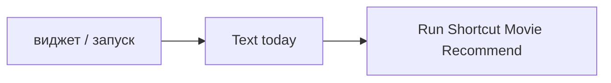

# Movie Tonight

## Назначение

Обёртка [Movie Recommend](../recommend/README.md) для виджета на Home Screen: тап — сразу карточка одного тайтла на вечер, без меню.

## Вход / Выход

Вход: нет. Выход: нет.

## Схема



## Шаги

1. **Text** `today`.
2. **Run Shortcut** Movie Recommend, Input = Text.

Дальше всё в Movie Recommend, режим `today` (сначала — синхронизация раз в день через [Movie Sync](../sync/README.md)): без меню и фильтров → скоринг всех кандидатов → топ-10 → **Get Random Item from List** → Movie Card. «Назад» в карточке — конец. Кандидатов нет → уведомление «Список пуст — добавь через Movie Add».

## Действия

```
// ── Шаг 1. Режим ──
Text "today"

// ── Шаг 2. Recommend ──
Run Shortcut "Movie Recommend" with [Text]
```

## Виджет

Главный экран → долгое нажатие → Edit → Add Widget → Shortcuts → в настройках виджета выбрать **Movie Tonight**.
