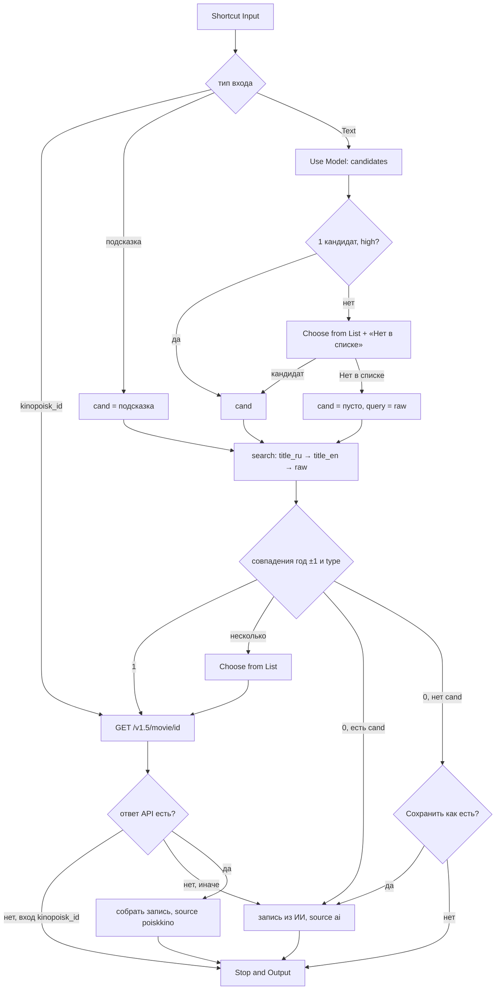

# Movie Lookup

## Назначение

Суб-шорткат: по запросу находит тайтл и возвращает запись (поля — [data.md](../data.md)). Ничего не сохраняет. ИИ распознаёт, что имел в виду пользователь, poiskkino даёт точные данные; если poiskkino не нашёл — запись строится из данных ИИ (данные не теряются).

## Вход / Выход

| Вход (Shortcut Input) | Что делает |
|---|---|
| Text | свободный запрос пользователя («разделение сериал», «Severance») |
| Dictionary `{kinopoisk_id}` | прямой запрос карточки |
| Dictionary `{title_en, title_ru, year, type}` | подсказка (из рекомендаций ИИ) — без шага ИИ |
| Dictionary `{query, voice: true}` | голосовой режим из [Movies](../voice/README.md): как Text, но все вопросы и подписи — по-английски (их читает Siri) |

Выход (Stop and Output): Dictionary — запись без `status`, `origin`, `added_date`, `watched_date`, `my_rating`, `tags`, `note`. Отмена пользователем → Stop and Output ничего (вызывающий проверяет `If Shortcut Result has any value`).

## Схема



## Шаги

Плоский список действий для сборки в редакторе — [actions.md](actions.md).

Как читать: каждое действие — отдельный пункт, в порядке добавления в редактор. Вложенность = то, что лежит внутри If / Otherwise / Repeat. Переходов «к шагу N» в Shortcuts нет — пропуск делается через If. Переменная, заданная внутри If, видна и после End If; не заданная — пустая (`has any value` = нет). `a.b` в Get Dictionary Value — путь по вложенным словарям (`rating.kp`).

### Подготовка

1. Настройки:
    1. **Get Value** (Data Jar) `movies.settings` → **Set Variable** `settings`.
    2. **If** `settings` does not have any value → **Show Notification** «Нет movies.settings — см. README, Установка» → **Stop This Shortcut** → **End If**.
2. Ключ API:
    1. **Get Dictionary Value** `poiskkino_api_key` из `settings` → **Set Variable** `apiKey`.
    2. **If** `apiKey` does not have any value → **Show Notification** «Нет ключа poiskkino в movies.settings» → **Stop This Shortcut** → **End If**.
3. **Get Dictionary Value** `genre_map` из `settings` → **Set Variable** `genreMap`.
4. **Get Dictionary Value** `genres` из `settings` → **Combine Text** через `, ` → **Set Variable** `genreList`. Жанры текстом не вписывать — источник один: `movies.settings.genres`.
5. **Get Dictionary Value** `type_map` из `settings` → **Set Variable** `typeMap` (тип poiskkino → наш, [data.md](../data.md#type)). Таблицу текстом не вписывать — источник один: `movies.settings.type_map`.
6. **Get Dictionary Value** `kinopoisk_id` из **Shortcut Input** → **Set Variable** `kpId`. (Вход Text → пусто.)
7. **Get Dictionary Value** `title_en` из **Shortcut Input** → **Set Variable** `hintTitle`.
8. Сырой ввод `query`:
    1. **Get Dictionary Value** `query` из **Shortcut Input**.
    2. **If** Dictionary Value has any value:
        1. **Set Variable** `query` = Dictionary Value (голос).
    3. **Otherwise**:
        1. **If** (All) `kpId` does not have any value, `hintTitle` does not have any value → **Set Variable** `query` = **Shortcut Input** (вход — Text) → **End If**.
    4. **End If**.
9. **Get Dictionary Value** `voice` из **Shortcut Input** → **Set Variable** `voice` (`true` — вызвал голосовой Movies; пусто — вызвали Add / Card с экрана телефона: меню и тексты по-русски).
10. Тексты интерфейса — дальше берутся из `ui`, текстом не вписывать:
    1. **If** `voice` has any value:
        1. **Dictionary** (англ., таблица ниже) → **Set Variable** `ui`.
        2. **Get Dictionary Value** `type_labels_en` из `settings` → **Set Variable** `typeLabels`.
    2. **Otherwise**:
        1. **Dictionary** (рус.) → **Set Variable** `ui`.
        2. **Get Dictionary Value** `type_labels` из `settings` → **Set Variable** `typeLabels`.
    3. **End If**.

    | Ключ | Голос (англ.) | Экран (рус.) |
    |---|---|---|
    | `which` | Which one? | Что именно? |
    | `none` | None of these | Нет в списке |
    | `not_found` | Not found. Save as is? | Не найдено. Сохранить как есть? |
    | `yes` / `no` | Yes / No | Да / Нет |
    | `year` | Which year? | Год? |
    | `type` | What type? | Тип? |

    Choose from Menu не берёт пункты из переменных — поэтому везде, где пункты зависят от языка, — **Choose from List**.

### Определить `foundId` (ветки A / B / C)

11. **If** `kpId` has any value (ветка A — вход `{kinopoisk_id}`):
    1. **Set Variable** `foundId` = `kpId`.
12. **Otherwise** — внутри шаги 13–21:
13. **If** `hintTitle` has any value (ветка B — подсказка от рекомендаций):
    1. **Set Variable** `cand` = **Shortcut Input**.
14. **Otherwise** (ветка C — текст) — внутри шаги 15–17:
15. Спросить ИИ:
    1. **Get Dictionary Value** `ai_enabled` из `settings`.
    2. **If** Dictionary Value is False → ничего (пустая ветка). **Otherwise** (true или не задано):
        1. **Use Model** (Private Cloud Compute, Output: **Dictionary**) — [промпт 1](#промпты-ии), вставить `query` и `genreList`.
        2. **Get Dictionary Value** `candidates` из ответа → **Set Variable** `cands`.
        3. **If** `cands` does not have any value — [запасной путь](../data.md#ответ-ии-use-model):
            1. **Use Model** — тот же промпт + строка `Return ONLY valid JSON, no markdown, no explanations.`, Output: **Text**.
            2. **Replace Text** ```` ```json ```` → пусто; **Replace Text** ```` ``` ```` → пусто.
            3. **Get Dictionary from Input** → **Get Dictionary Value** `candidates` → **Set Variable** `cands`.
            4. **If** `cands` does not have any value → **Show Notification** «ИИ не ответил» → **End If**.
        4. **End If**.
    3. **End If**. (ИИ выключен или не ответил → `cands` пуст → `cand` пуст → шаг 20 ищет по сырому вводу.)
16. **If** `cands` has any value — выбор кандидата:
    1. **Count** `cands` → **Set Variable** `nCands`.
    2. **Get Item from List** (First Item) `cands` → **Get Dictionary Value** `confidence` → **Set Variable** `conf1`.
    3. **If** (All) `nCands` is 1, `conf1` is `high`:
        1. **Get Item from List** (First Item) `cands` → **Set Variable** `cand`.
    4. **Otherwise** — спросить пользователя:
        1. **Dictionary** (пустой) → **Set Variable** `labelMap`.
        2. **Repeat with Each** `cands`:
            1. **If** `voice` has any value → **Text** `title_en (year, type)` → **Set Variable** `label`. **Otherwise** → **Text** `title_ru / title_en (year, type)` → **Set Variable** `label`. **End If**. (Поля — Repeat Item → тап → ключ.)
            2. **Add to Variable** `labels` ← `label`.
            3. **Set Dictionary Value** в `labelMap`: ключ `label`, значение Repeat Item → **Set Variable** `labelMap`.
        3. **End Repeat**.
        4. **Get Dictionary Value** `none` из `ui` → **Add to Variable** `labels`.
        5. **Choose from List** `labels`, Prompt = `ui.which`. Отмена останавливает только Lookup — вызывающий получит пусто ([мини-тест 4](../README.md#1-мини-тесты-ios-до-сборки)).
        6. **If** Chosen Item is not `ui.none` → **Get Dictionary Value** Chosen Item из `labelMap` → **Set Variable** `cand` → **End If**. (Выбрал «Нет в списке» → `cand` пуст, поиск по сырому вводу.)
    5. **End If**.
17. **End If** (`cands`).
18. **End If** (`hintTitle`, ветки B/C).

### Поиск в poiskkino (ветки B и C)

19. Список запросов `queries` (пустые пропускаем):
    1. **Get Dictionary Value** `title_ru` из `cand` → **If** has any value → **Add to Variable** `queries` → **End If**.
    2. **Get Dictionary Value** `title_en` из `cand` → **If** has any value → **Add to Variable** `queries` → **End If**.
    3. **If** `query` has any value → **Add to Variable** `queries` ← `query` → **End If**.
20. **Repeat with Each** `queries`:
    1. **If** (All) `docsMatched` does not have any value, `apiErr` is not 1 (уже нашли или API упал → остальные запросы пропускаем):
        1. **URL Encode** Repeat Item.
        2. **Text** `https://api.poiskkino.dev/v1.5/movie/search?query=<URL Encoded Text>&limit=5`.
        3. **Get Contents of URL** — Method GET, Headers: `X-API-KEY` = `apiKey` → **Set Variable** `resp`.
        4. **Get Dictionary Value** `statusCode` из `resp`.
        5. **If** Dictionary Value has any value (ошибка API):
            1. **Get Dictionary Value** `message` из `resp` → **Show Notification** `poiskkino: <statusCode> <message>`.
            2. **Number** 1 → **Set Variable** `apiErr`.
        6. **Otherwise**:
            1. **Get Dictionary Value** `docs` из `resp` → **Repeat with Each** (Repeat Item 2 = doc):
                1. **If** `cand` has any value:
                    1. **Get Dictionary Value** `type` из doc → **Get Dictionary Value** (этот текст) из `typeMap` → **Set Variable** `docType` (пусто → **Text** `movie`).
                    2. **Get Dictionary Value** `type` из `cand` → **Set Variable** `candType`. **If** `candType` is `documentary` → **Set Variable** `candType` = `movie` → **End If** (у poiskkino документалки — `movie`).
                    3. **Calculate** `year` doc − `year` `cand` → **Set Variable** `dy`.
                    4. **If** (All) `docType` is `candType`, `dy` is between −1 and 1 → **Add to Variable** `docsMatched` ← Repeat Item 2 → **End If**.
                2. **Otherwise** → **Add to Variable** `docsMatched` ← Repeat Item 2.
                3. **End If**.
            2. **End Repeat**.
        7. **End If**.
    2. **End If**.
21. **End Repeat**. Выбрать `foundId`:
    1. **Count** `docsMatched` → **Set Variable** `nDocs`.
    2. **If** `nDocs` is 1 → **Get Item from List** (First) `docsMatched` → **Get Dictionary Value** `id` → **Set Variable** `foundId`.
    3. **Otherwise** → **If** `nDocs` is greater than 1:
        1. **Dictionary** (пустой) → **Set Variable** `docMap`.
        2. **Repeat with Each** `docsMatched`: **Text** `name / alternativeName (year, type)` (голос — `alternativeName (year, type)`, как в шаге 16) → **Add to Variable** `docLabels`; **Set Dictionary Value** в `docMap`: ключ — текст, значение — `id` → **Set Variable** `docMap`. **End Repeat**.
        3. **Choose from List** `docLabels`, Prompt = `ui.which` → **Get Dictionary Value** Chosen Item из `docMap` → **Set Variable** `foundId`.
    4. **End If** (`nDocs` > 1) → **End If** (`nDocs` = 1). 0 → `foundId` пуст.
22. **End If** (`kpId`, ветка A / остальные).

### Собрать запись

23. **If** `foundId` has any value:
    1. **Text** `https://api.poiskkino.dev/v1.5/movie/<foundId>` → **Get Contents of URL** (GET, Header `X-API-KEY` = `apiKey`) → **Set Variable** `m`.
    2. **Get Dictionary Value** `id` из `m` → **Set Variable** `mId`.
    3. **If** `mId` does not have any value (ошибка API, лимит):
        1. **Get Dictionary Value** `statusCode`, `message` из `m` → **Show Notification** `poiskkino: <statusCode> <message>` ([ошибки](../data.md#ошибки)).
        2. **If** `kpId` has any value (ветка A) → **Stop This Shortcut** — вызывающий получит пусто и ничего не перезапишет → **End If**. Ветки B/C идут дальше: `mId` пуст → шаг 25 (запись из ИИ).
    4. **End If**.
24. **End If**. (Нет `foundId` → `mId` пуст — это просто «не найдено», не ошибка.)
25. **If** `mId` has any value — запись из poiskkino:
    1. `title_en`: **Get Dictionary Value** `enName` из `m` → **If** has any value → **Set Variable** `title_en`. **Otherwise** → **Get Dictionary Value** `alternativeName` → **Match Text** `^[\p{Latin}\d\s\p{P}\p{S}]+$` → **If** Matches has any value → **Set Variable** `title_en` = `alternativeName`; **Otherwise** → `title_en` = `title_en` из `cand` → **End If** → **End If**.
    2. `title_ru`: **Get Dictionary Value** `name` из `m` → есть → **Set Variable** `title_ru`; иначе — `title_ru` из `cand`.
    3. `genres` ([алгоритм](../data.md#маппинг-poiskkino--канон-moviessettingsgenre_map)):
        1. **Dictionary** (пустой) → **Set Variable** `genreSet` (словарь вместо списка — убирает дубли).
        2. **Get Dictionary Value** `genres` из `m` → **Repeat with Each**: **Get Dictionary Value** `name` из Repeat Item → **Get Dictionary Value** (Key = это имя) из `genreMap` → **Set Variable** `canon` → **If** `canon` has any value → **If** `canon` is not `drop` → **Set Dictionary Value** в `genreSet`: Key = `canon`, Value `1` → **Set Variable** `genreSet` → **End If** → **End If**. **End Repeat**.
        3. **Get Dictionary Value** **All Keys** из `genreSet` → **Set Variable** `genres`.
    4. `type`: **Get Dictionary Value** `type` из `m` → **Get Dictionary Value** (этот текст) из `typeMap` → **Set Variable** `type` (пусто → `movie`). **If** `type` is `movie` → **Get Dictionary Value** `Documentary` из `genreSet` → **If** has any value → **Set Variable** `type` = `documentary` → **End If** → **End If**.
    5. `ratings`: **Dictionary** (пустой) → **Set Variable** `ratings`. **Get Dictionary Value** `rating.imdb` из `m` → **If** is greater than 0 → **Round Number** (Tenths) → **Set Dictionary Value** `imdb` в `ratings` → **Set Variable** `ratings` → **End If**. То же для `rating.kp` → `kp`.
    6. `length`: **Get Dictionary Value** `seriesLength` из `m` → **If** is greater than 0 → **Set Variable** `length` (сериал — длина серии). **Otherwise** → **Get Dictionary Value** `movieLength` из `m` → **If** is greater than 0 → **Set Variable** `length` → **End If** → **End If**. (У фильмов `seriesLength` пуст, поэтому проверять `type` не нужно; 0 или пусто → `length` не задаётся.)
    7. `premiere_date`: **Get Dictionary Value** `premiere.world` из `m`, пусто → `premiere.russia` → **If** has any value → **Get Dates from Input** → **Format Date** Custom `yyyy-MM-dd` → **Set Variable** `premiere_date` → **End If**.
    8. `seasons_count`: сериальный тип (как в п. 6) и **Get Dictionary Value** `seasonsInfo` has any value → **Count** → **Set Variable** `seasons_count`. Обычно null — не задавать, заполнит Movie Seasons.
    9. `description`: **Get Dictionary Value** `shortDescription` → есть → **Set Variable** `description`. Иначе **Get Dictionary Value** `description` → **Split Text** Custom `. ` → **Get Item from List** (First) → **Text** `<item>.` → **Set Variable** `description`.
    10. Ключ: **Get Dictionary Value** `externalId.imdb` из `m` → **If** has any value → **Set Variable** `imdb_id`, **Set Variable** `key` = он же. **Otherwise** → **Text** `kp-<mId>` → **Set Variable** `key`. **End If**.
    11. **Dictionary** — обязательные поля: `key`, `title_en`, `title_ru`, `year` (`m.year`), `type`, `genres`, `kinopoisk_id` = `mId`, `ratings`, `source` = `poiskkino`, `updated_date` = Current Date → **Format Date** ISO 8601 → **Set Variable** `rec`.
    12. Необязательные — только если есть значение (**If** has any value → **Set Dictionary Value** в `rec` → **Set Variable** `rec`): `imdb_id`, `length`, `age_rating` (`m.ageRating`), `premiere_date`, `seasons_count`, `release_status` (`m.status`), `description`, `poster_url` (`m.poster.url`). Пустое не писать — null = ключа нет ([data.md](../data.md#запись-moviesitemskey)).
26. **Otherwise** (ветка D — не найдено или API упал):
    1. **If** `cand` has any value — запись из ИИ:
        1. Ключ ([data.md](../data.md#ключ-записи)). Источник и год:
            0. **Get Dictionary Value** `title_en` из `cand` → **Set Variable** `src`. **Get Dictionary Value** `year` из `cand` → **Set Variable** `yrK`.
            1. **Match Text** `[a-zA-Z]` в `src`.
            2. **If** Matches has any value (есть латиница):
                1. **Text** `src` → **Change Case** lowercase → **Replace Text** ` ` → `-` → **Replace Text** (Regular Expression) `[^a-z0-9-]` → пусто → **Replace Text** (Regular Expression) `-+` → `-` → **Replace Text** (Regular Expression) `^-+|-+$` → пусто → **Text** `ai-<Updated Text>` → **Set Variable** `key`.
            3. **Otherwise** (кириллица, нет латиницы):
                1. **Date** (Current Date) → **Format Date** Custom `yyyyMMddHHmm` → **Text** `ai-<Formatted Date>` → **Set Variable** `key`.
            4. **End If**.
            5. **If** `yrK` has any value → **Text** `<key>-<yrK>` → **Set Variable** `key` → **End If**.
        2. (пример: `The Brutalist`, 2024 → `ai-the-brutalist-2024`; `Брат 2`, 2000 → `ai-202610241530-2000`.)
        3. **Dictionary**: `key`, `title_en`, `title_ru`, `year`, `type`, `genres` — из `cand`; `ratings` = пустой Dictionary; `source` = `ai`; `updated_date` = Current Date ISO 8601 → **Set Variable** `rec`.
    2. **Otherwise** (пользователь отверг варианты ИИ, и poiskkino пусто):
        1. **List** [`ui.yes`, `ui.no`] → **Choose from List**, Prompt = `ui.not_found`.
        2. **If** Chosen Item is `ui.no` → **Stop This Shortcut** → **End If**.
        3. **Ask for Input** — Number, Prompt = `ui.year`, можно пусто → **Set Variable** `yr`.
        4. Тип — [выбор типа](../data.md#type) по `typeLabels`, Prompt = `ui.type` → **Set Variable** `type`.
        5. Ключ — те же действия, что в 26.1.1, но п. 0 другой: **Set Variable** `src` = `query`, **Set Variable** `yrK` = `yr`. Кириллица (`Брат 2`) → сразу `ai-<yyyyMMddHHmm>`, без slug.
        6. **Dictionary**: `key`, `title_ru` = `title_en` = `query`, `year` = `yr` (если есть), `type`, `genres` = пустой список, `ratings` = пустой Dictionary, `source` = `ai`, `updated_date` → **Set Variable** `rec`. Позже — «Обновить данные» в карточке.
    3. **End If**.
27. **End If** (`mId`).
28. **Stop and Output** `rec`.

## Промпты ИИ

Промпт 1 (Use Model, Private Cloud Compute, Output: Dictionary). Вставки: `[query]`, `[genreList]`.

```
The user typed a request to find a movie or TV series. It may be in Russian or English, may contain typos, partial titles, actor names, or a description of the plot.

If the request came from voice, Russian titles may appear as a rough English transcription (for example "brat two" may mean "Брат 2").

User request: [query]

Identify up to 3 titles the user most likely means, most likely first.
Return a dictionary with key "candidates": a list of up to 3 dictionaries, each with:
- "title_en": official English title (string)
- "title_ru": official Russian release title (string; transliterate or translate if no official one)
- "year": release year of the first release (number)
- "type": exactly one of: movie, tv_show, animation, animated_series, anime, documentary
- "genres": list of 1 to 4 genres, chosen ONLY from this list: [genreList]
- "confidence": exactly one of: high, medium, low

Use "high" only if the request unambiguously identifies one title.
If you do not recognize the title at all, return your best guess of the English and Russian title with confidence "low"; the title may be newer than your knowledge.
Do not invent extra keys.
```

## Data Jar

Читает: `movies.settings` (`poiskkino_api_key`, `genre_map`, `genres`, `type_labels`, `type_labels_en`, `ai_enabled`, `type_map`). Пишет: ничего.

## Расход запросов poiskkino

| Сценарий | Запросов |
|---|---|
| `{kinopoisk_id}` | 1 |
| найдено с первого запроса | 2 (search + movie/{id}) |
| найдено по 2-му/3-му запросу | 3–4 |
| не найдено | до 3 |

В среднем ~2.

## Заметки / ограничения

- У ИИ есть дата отсечения знаний: новинки он может не знать — поэтому поиск идёт и по сырому вводу, и пункт «Нет в списке».
- `alternativeName` бывает не на английском (оригинал на корейском и т. п.) — проверка на латиницу обязательна.
- Совпадение типов: poiskkino `movie` ↔ наш `documentary` считать совпадением.
- Ошибка HTTP / пустой ответ (лимит исчерпан): в поиске → `docs` пусто → ветка D, запись из ИИ; в `movie/{id}` → проверка `mId` (шаг 23), при входе `{kinopoisk_id}` выход пустой, чтобы «Обновить данные» не затёрло запись. Позже можно «Обновить данные» в карточке — но у `ai-`-записи нет `kinopoisk_id`, тогда Обновить делает Lookup по `{title_en,title_ru,year,type}`.
- Use Model требует Apple Intelligence и сеть (PCC).
