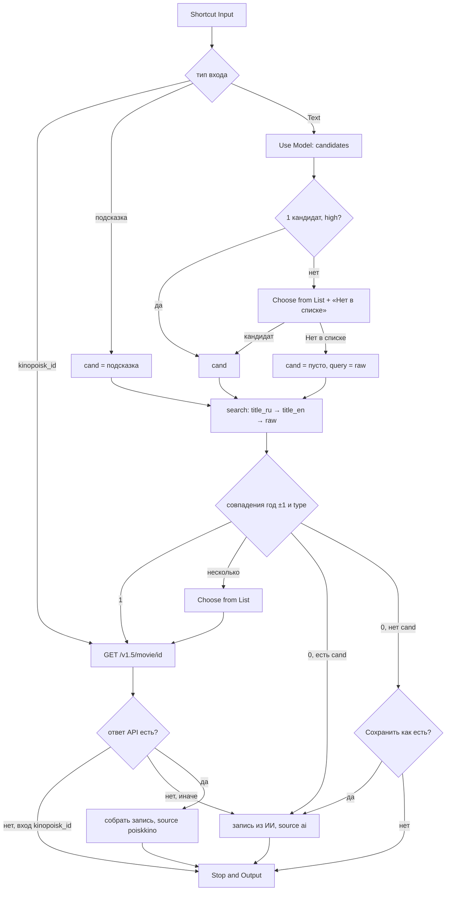

# Movie Lookup

## Назначение

Суб-шорткат: по запросу находит тайтл и возвращает запись (поля — [data.md](../data.md)). Ничего не сохраняет. ИИ распознаёт, что имел в виду пользователь, poiskkino даёт точные данные; если poiskkino не нашёл — запись строится из данных ИИ (данные не теряются).

## Вход / Выход

| Вход (Shortcut Input) | Что делает |
|---|---|
| Text | свободный запрос пользователя («разделение сериал», «Severance») |
| Dictionary `{kinopoisk_id}` | прямой запрос карточки |
| Dictionary `{title_en, title_ru, year, type}` | подсказка (из рекомендаций ИИ) — без шага ИИ |
| Dictionary `{query, voice: true}` | голосовой режим из [Movies](../voice/README.md): как Text, но все вопросы и подписи — по-английски (их читает Siri) |

Выход (Stop and Output): Dictionary — запись без `status`, `origin`, `added_date`, `watched_date`, `my_rating`, `tags`, `note`. Отмена пользователем → Stop and Output ничего (вызывающий проверяет `If Shortcut Result has any value`).

## Схема



## Шаги

### Подготовка

1. **Get Value** (Data Jar) `movies.settings` → Set Variable `settings`. [Проверка настроек](../data.md#ошибки): нет настроек или ключа → уведомление → **Stop This Shortcut**.
2. **Get Dictionary Value** `poiskkino_api_key` из `settings` → `apiKey`.
3. **Get Dictionary Value** `genre_map` из `settings` → `genreMap`.
4. **Text** — канонический список жанров через запятую (из [data.md](../data.md#жанры)) → `genreList`.
5. **Get Dictionary Value** `kinopoisk_id` из Shortcut Input → `kpId`. (Для Text-входа результат пустой.)
6. **Get Dictionary Value** `title_en` из Shortcut Input → `hintTitle`.
6a. `query` = `query` из входа, если есть (голос), иначе Shortcut Input, если это Text. `voice` = `voice` из входа (пусто = нет). Дальше «сырой ввод» = `query`.
6b. Голос → подписи списков `title_en (year, type)`, пункты и вопросы по-английски: «Which one?», «None of these», «Not found. Save as is?» Yes / No, «Which year?», «Movie or series?». Иначе — русские, как ниже.

### Определить `foundId` (ветки A / B / C)

7. **If** `kpId` has any value → `foundId` = `kpId` (ветка A). **Otherwise** → шаги 8–17. **End If** — после шага 17.
8. **If** `hintTitle` has any value → `cand` = Shortcut Input (ветка B). **Otherwise** → шаги 9–13 (ветка C). **End If** — после шага 13.
9. `ai_enabled` = `false` → `cand` пуст, сразу шаг 14. Иначе **Use Model** (Private Cloud Compute, Output: Dictionary) — промпт 1 с `query`, `genreList` → `ai` ([запасной путь](../data.md#ответ-ии-use-model)). ИИ не ответил → `cand` пуст, сразу шаг 14 (поиск по сырому вводу).
10. **Get Dictionary Value** `candidates` из `ai` → `cands`. **Count** `cands`.
11. **If** Count = 1 **и** `confidence` первого = `high` (вложенные If) → `cand` = Get Item from List (First) `cands`. **Otherwise** → шаги 12–13.
12. **Repeat with Each** `cands`: **Text** `title_ru / title_en (year, type)` → **Add to Variable** `labels`; **Set Dictionary Value** label → item в `labelMap`. End Repeat. **Add to Variable** `labels` «Нет в списке». **Choose from List** `labels` («Что именно?»). Отмена → **Stop and Output** пусто.
13. **If** Chosen Item ≠ «Нет в списке» → `cand` = Get Dictionary Value Chosen Item из `labelMap` (иначе `cand` пуст).
14. Список запросов `queries`: `cand.title_ru`, `cand.title_en`, `query` — пустые пропускать.
15. **Repeat with Each** `queries`:
    1. **If** `docsMatched` has any value **или** `apiErr` = 1 → ничего (уже найдено / API упал).
    2. Otherwise → **URL Encode** Repeat Item → **Text** `https://api.poiskkino.dev/v1.5/movie/search?query=<encoded>&limit=5` → **Get Contents of URL** (GET, Header `X-API-KEY: apiKey`) → `resp` → **Get Dictionary Value** `docs`. `resp.statusCode` есть (ошибка API) → **Show Notification** `poiskkino: <statusCode> <message>`, `apiErr` = 1 (остальные запросы пропускаются: тот же ключ — та же ошибка) → в итоге ветка D.
    3. Есть `cand`: **Repeat with Each** doc → маппинг `type` ([data.md](../data.md#type)) == `cand.type` (movie/documentary считать равными) **и** |`year` − `cand.year`| ≤ 1 (Calculate) → **Add to Variable** `docsMatched`. Нет `cand` → все docs → `docsMatched`.
16. **Count** `docsMatched`: 1 → `foundId` = `id`; > 1 → **Choose from List** «name / alternativeName (year, type)» → `foundId` (отмена → **Stop and Output** пусто); 0 → `foundId` пуст.
17. (конец ветки B/C)

### Собрать запись

18. **If** `foundId` has any value → **Text** `https://api.poiskkino.dev/v1.5/movie/<foundId>` → **Get Contents of URL** (Header `X-API-KEY`) → `m`. (Нет `foundId` → `m` пуст, шаг 19 пропустить — это просто «не найдено», а не ошибка.)
19. **If** `foundId` есть, а `m.id` does not have any value (ошибка API, лимит) → **Show Notification** `poiskkino: <m.statusCode> <m.message>` ([ошибки](../data.md#ошибки)) и:
    - ветка A (вход `{kinopoisk_id}`) → **Stop and Output** пусто — вызывающий ничего не перезаписывает;
    - ветки B/C → `foundId` = пусто → шаг 21 (запись из ИИ).
20. **If** `m.id` есть — запись из poiskkino:
    1. `title_en` = `enName` → иначе `alternativeName`, если **Match Text** латиница → иначе `cand.title_en`.
    2. `title_ru` = `name` → иначе `cand.title_ru`.
    3. `genres`: **Repeat with Each** `m.genres` → алгоритм [data.md](../data.md#маппинг-poiskkino--канон-moviessettingsgenre_map) → **Add to Variable** `genres`.
    4. `type`: **Dictionary**-маппинг типов → Get Dictionary Value; `movie` + `Documentary` в `genres` → `documentary`.
    5. `ratings`: **Dictionary** `{imdb, kp}`, **Round Number** до 0.1 (`rating.kp` приходит как `7.168`); значение 0 или нет → ключ не задавать.
    6. `length` = `seriesLength` если тип сериальный, иначе `movieLength`.
    7. `premiere_date` = `premiere.world` или `premiere.russia` → **Get Dates from Input** → **Format Date** `yyyy-MM-dd`.
    8. `seasons_count` = **Count** `seasonsInfo` (только сериалы, если не null; обычно null — поле не задавать, его заполнит Movie Seasons).
    9. `description` = `shortDescription`, иначе **Split Text** `description` по `. ` → первый + `.`.
    10. Ключ: `externalId.imdb` → иначе `kp-<id>`.
    11. **Dictionary** — все поля, `source` = `poiskkino`, `updated_date` = Current Date (ISO).
21. **Otherwise** (ветка D, не найдено):
    - есть `cand` → **Dictionary** из `cand`: `title_en, title_ru, year, type, genres`, `ratings` `{}`, `source` = `ai`, ключ `ai-<slug>-<year>` ([data.md](../data.md#ключ-записи));
    - нет `cand` (пользователь отверг варианты ИИ, и poiskkino пусто) → **Choose from Menu** «Не найдено. Сохранить как есть?» Да / Нет. Нет → **Stop and Output** пусто. Да → **Ask for Input** год (Number, можно пусто) и **Choose from Menu** тип ([data.md](../data.md#type)) → **Dictionary** `title_ru` = `title_en` = `query`, `year`, `type`, `genres` [], `ratings` `{}`, `source` = `ai`, ключ `ai-<slug>-<year>` (slug пустой из кириллицы → `ai-<Current Date yyyyMMddHHmm>`; год пуст → без `-<year>`). Позже — «Обновить данные» в карточке.
22. **Stop and Output** запись.

## Промпты ИИ

Промпт 1 (Use Model, Private Cloud Compute, Output: Dictionary). Вставки: `[query]`, `[genreList]`.

```
The user typed a request to find a movie or TV series. It may be in Russian or English, may contain typos, partial titles, actor names, or a description of the plot.

If the request came from voice, Russian titles may appear as a rough English transcription (for example "brat two" may mean "Брат 2").

User request: [query]

Identify up to 3 titles the user most likely means, most likely first.
Return a dictionary with key "candidates": a list of up to 3 dictionaries, each with:
- "title_en": official English title (string)
- "title_ru": official Russian release title (string; transliterate or translate if no official one)
- "year": release year of the first release (number)
- "type": exactly one of: movie, tv_show, animation, animated_series, anime, documentary
- "genres": list of 1 to 4 genres, chosen ONLY from this list: [genreList]
- "confidence": exactly one of: high, medium, low

Use "high" only if the request unambiguously identifies one title.
If you do not recognize the title at all, return your best guess of the English and Russian title with confidence "low"; the title may be newer than your knowledge.
Do not invent extra keys.
```

## Data Jar

Читает: `movies.settings` (`poiskkino_api_key`, `genre_map`). Пишет: ничего.

## Расход запросов poiskkino

| Сценарий | Запросов |
|---|---|
| `{kinopoisk_id}` | 1 |
| найдено с первого запроса | 2 (search + movie/{id}) |
| найдено по 2-му/3-му запросу | 3–4 |
| не найдено | до 3 |

В среднем ~2.

## Заметки / ограничения

- У ИИ есть дата отсечения знаний: новинки он может не знать — поэтому поиск идёт и по сырому вводу, и пункт «Нет в списке».
- `alternativeName` бывает не на английском (оригинал на корейском и т. п.) — проверка на латиницу обязательна.
- Совпадение типов: poiskkino `movie` ↔ наш `documentary` считать совпадением.
- Ошибка HTTP / пустой ответ (лимит исчерпан): в поиске → `docs` пусто → ветка D, запись из ИИ; в `movie/{id}` → проверка `m.id` (шаг 19), при входе `{kinopoisk_id}` выход пустой, чтобы «Обновить данные» не затёрло запись. Позже можно «Обновить данные» в карточке — но у `ai-`-записи нет `kinopoisk_id`, тогда Обновить делает Lookup по `{title_en,title_ru,year,type}`.
- Use Model требует Apple Intelligence и сеть (PCC).
