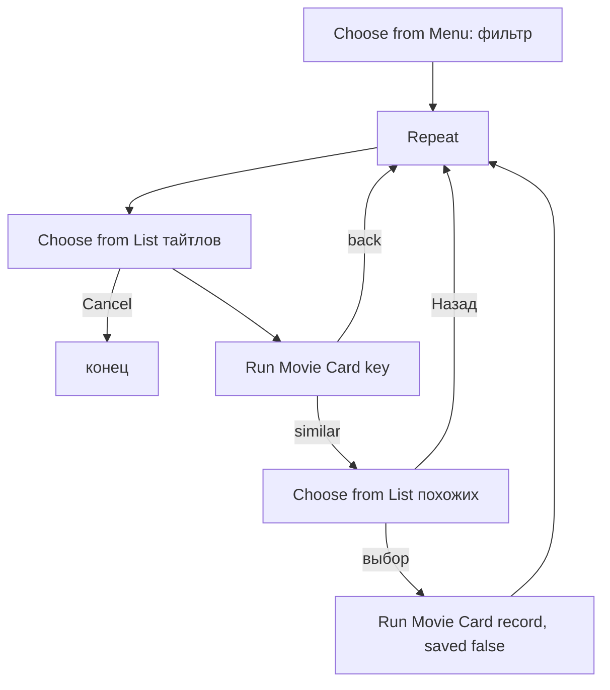

# Movie Rate

## Назначение

Просмотр списка по статусу и вход в карточку для оценки/правки. Вся работа с тайтлом — в Movie Card.

## Вход / Выход

Вход: нет. Выход: нет. Выход из шортката — Done / Cancel в любом списке.

## Схема

## Шаги

1. **Choose from Menu** «Показать»: Несмотренные / Смотрю / Посмотренные / Бросил / Скрытые / Все → Set Variable `filter` = `unwatched` / `watching` / `watched` / `dropped` / `dismissed` / `all`. «Скрытые» — чтобы вернуть тайтл в рекомендации (Статус в карточке).
2. **Repeat** 100 раз:
   1. **Get Value** `movies.items` → **Get Dictionary Value** All Values → `all`.
   2. **Repeat with Each** `all`: **If** `filter` = `all` → берём всё, кроме `status` = `dismissed`; иначе — только `status` = `filter` → **Add to Variable** `items`.
   3. `items` пуст → **Show Notification** «Пусто» → **Stop This Shortcut**.
   4. **Repeat with Each** `items`:
      - **Text** метка: `title_ru / title_en (year)`; если `my_rating` → дописать ` ★ my_rating`; если `status` = `watching` и `filter` = `all` → ` ▶`.
      - Если метка уже есть в `labelMap` (ремейк того же года и т. п.) → дописать ` · key`.
      - **Add to Variable** `labels`; **Set Dictionary Value** метка → `key` в `labelMap`.
   5. Без сортировки — порядок, как отдаёт Data Jar (обычно порядок добавления).
   6. **Choose from List** `labels` (prompt «filter: N»). Cancel → шорткат завершается.
   7. **Get Dictionary Value** Chosen Item из `labelMap` → `key`.
   8. **Run Shortcut** Movie Card, Input **Dictionary** `{key}` → `res`.
   9. **If** `res.action` = `similar` → показать похожие:
      - **Repeat with Each** `res.items` → метка `title_ru / title_en (year)` + ` — IMDb x` или ` — КП y` (у похожих из poiskkino есть только КП) → `simLabels`, `simMap`.
      - **Add to Variable** `simLabels` «← Назад».
      - **Choose from List** → «← Назад» → ничего. Иначе → **Run Shortcut** Movie Card `{record: item, saved: false}`.
   10. Очистить `items`, `labels`, `labelMap`, `simLabels`, `simMap` (Set Variable пустым) — следующий оборот перечитывает базу (статус мог измениться).
3. End Repeat.

## Промпты ИИ

Нет.

## Data Jar

Читает: `movies.items`. Пишет: только через Movie Card.

## Расход запросов poiskkino

0 сам по себе. Карточка — см. [card](../card/README.md#расход-запросов-poiskkino).

## Заметки / ограничения

- Сортировки по алфавиту нет (в Shortcuts её нет, сторонние приложения не используем). Choose from List умеет искать по тексту — для длинного списка этого хватает.
- Повторное нажатие на ту же запись после оценки — метка уже с ★, т. к. база перечитывается.
- Cancel в Choose from List полностью останавливает шорткат — это и есть выход.
