# Movie Recommend

## Назначение

Подобрать, что посмотреть. Режимы:

| Режим | Откуда | ИИ | poiskkino |
|---|---|---|---|
| Мой список (по вкусу) | свои `unwatched`/`watching` | нет | 0 |
| Случайный | свои `unwatched`/`watching` | нет | 0 |
| По настроению (ИИ) | свои `unwatched`/`watching` | да | 0 |
| Новое (ИИ) | вне базы | да | 0 до открытия карточки |

Плюс обёртка **Movie Tonight** для виджета.

## Вход / Выход

Вход: нет | Text `today` (от Movie Tonight) | Dictionary `{mode: "voice", mood, types}` (от [Movies](../voice/README.md)). Выход: нет; в режиме `voice` — Text для Siri.

## Схема

Машина состояний: **Repeat** (200) + переменная `screen`. В начале каждого оборота — If по `screen`.

```mermaid
stateDiagram-v2
    [*] --> menu
    [*] --> today: вход "today"
    today --> card: случайный из топ-10
    menu --> filters: режим выбран
    menu --> [*]: Выход (Stop This Shortcut)
    filters --> list: фильтры / Без фильтров
    filters --> menu: ← Назад
    list --> card: выбран тайтл
    list --> menu: ← Назад
    list --> filters: пусто
    card --> list: back (taste — пересчёт; mood/new/похожие — кеш)
    card --> list: similar (items → список)
    card --> menu: back + «В меню» (random)
    card --> card: back + «Ещё случайный» (random)
    card --> [*]: back (режим today)
```



## Переменные

| Переменная | Что |
|---|---|
| `screen` | `menu` \| `filters` \| `list` \| `card` |
| `mode` | `taste` \| `random` \| `mood` \| `new` \| `today` \| `similar` (список «Похожие» из карточки) |
| `flt` | Dictionary фильтров `{types, genres, maxLen, tag}` |
| `listItems` | элементы текущего списка (записи или light records) + `predicted` |
| `selected` | выбранный элемент для card |
| `mood`, `answers` | настроение и ответы на уточнения (живут до выхода в меню) |
| `feedback`, `shown` | причины «↻ Не то…» и уже отвергнутые названия (живут до выхода в меню) |
| `settings`, `db` | `movies.settings`, все записи `movies.items` |

## Шаги

Плоский список действий для сборки в редакторе — [actions.md](actions.md).

### Подготовка

1. **Get Value** `movies.settings` → `settings` ([проверка настроек](../data.md#ошибки), ключ API не нужен). **Get Value** `movies.items` → Get Dictionary Value All Values → `db`.
2. **If** Shortcut Input = `today` → `mode` = `today`, `screen` = `list`. **If** **Get Type** входа = `Dictionary` и `mode` из входа = `voice` (Get Dictionary Value из Text `today` падает) → [голосовой режим](#голосовой-режим) (без цикла и экранов). Otherwise → `screen` = `menu`.
3. **Repeat** 200 раз → шаги ниже.

### screen = menu

4. **Choose from Menu** «Что смотрим?»: Мой список (по вкусу) / Случайный / По настроению (ИИ) / Новое (ИИ) / Выход.
5. Выход → **Stop This Shortcut**. По настроению / Новое при `ai_enabled` = `false` → **Show Notification** «ИИ выключен», остаться в меню. Иначе → `mode`, `listItems` = пусто, `feedback`, `shown`, `mood`, `answers` = пусто, `screen` = `filters`.

### screen = filters

6. **Choose from Menu** «Фильтры»: Без фильтров / Настроить / ← Назад.
   - ← Назад → `screen` = `menu`.
   - Без фильтров → `flt` = пустой Dictionary, `listItems` = пусто, `screen` = `list`.
   - Настроить:
     1. [Выбор типа](../data.md#type) по `settings.type_labels`, Choose from List Select Multiple → `flt.types` (enum-значения).
     2. **Choose from List** `settings.genres`, Select Multiple → `flt.genres`.
     3. **Choose from Menu** «Длительность»: Любая / ≤ 90 мин / ≤ 120 мин / ≤ 150 мин → `flt.maxLen` (пусто / 90 / 120 / 150).
     4. **Choose from List** (`settings.tags` + «Любой»; Choose from Menu не подходит — пункты статичны) → `flt.tag`.
     5. `listItems` = пусто, `screen` = `list`.
   Пустой выбор в multi-select = «любой».

### screen = list

7. **If** `listItems` пуст → построить (иначе — показать кеш: «Похожие», «По настроению», «Новое» после возврата из карточки):
   1. **Кандидаты** (для `taste` / `random` / `mood` / `today`): **Repeat with Each** `db` → оставить, если:
      - `status` ∈ {`unwatched`, `watching`};
      - `flt.types` пуст или содержит `type`;
      - `flt.genres` пуст или пересекается с `genres` (Repeat по `flt.genres`, If `genres` contains);
      - `flt.maxLen` пуст или `length` пуст или `length` ≤ `maxLen` (для сериалов `length` — длина серии);
      - `flt.tag` пуст/«Любой» или `tags` contains `flt.tag`.

      → `cands`. Пусто: `today` → **Show Notification** «Список пуст — добавь через Movie Add» → **Stop This Shortcut**; иначе → «Ничего не подходит» → `screen` = `filters`, к следующему обороту.
   2. Для всех режимов, кроме `random` и `similar`, сначала шаги 1–4 [скоринга](#скоринг-мой-список) — `genre_score` нужен и для `[topGenres]` в промптах. По `mode`:
      - **taste / today** → скоринг (ниже) для каждого из `cands` → `predicted`. Dictionary `scores` key → Final → [топ без сортировки](../data.md#топ-без-сортировки): `taste` — N = `top_n` → `listItems`; `today` — N = 10 → **Get Random Item from List** → `selected` → `screen` = `card`, к следующему обороту (список не показывать).
      - **random** → **Get Random Item from List** `cands` → `selected`, `screen` = `card`, к следующему обороту.
      - **mood** → `mood` уже есть (повтор после «↻ Не то…») → сразу промпт «Настроение». Иначе **Ask for Input** «Какое настроение?» → `mood`. Уточнение: **Use Model** промпт «Уточнение» → `questions` (0–2). **Repeat with Each**: **Choose from List** `options` + «Своё…» (prompt = `q`); «Своё…» → **Ask for Input**; → **Add to Variable** `answers` строкой `q — ответ`. Отмена/ИИ не ответил → без уточнений. Затем **Use Model** промпт «Настроение» ([запасной путь](../data.md#ответ-ии-use-model); не ответил → **Show Notification** «ИИ не ответил», `screen` = `menu`) → `picks`. Для каждого `pick.key` → запись из `cands` (ключа нет в `cands` — отбросить) + `reason` → `listItems`. `listItems` пуст → **Show Notification** «ИИ не подобрал из списка» → `screen` = `menu`.
      - **similar** → кеш опустел (всё посмотрено/скрыто) → **Show Notification** «Похожих не осталось» → `screen` = `menu`.
      - **new** → **Use Model** промпт «Новое» (запасной путь; не ответил → «ИИ не ответил», `screen` = `menu`) → `items` (light records + `reason`) → фильтр по `db` (см. после промпта) → `listItems`. `listItems` пуст → **Show Notification** «Всё предложенное уже в базе» → `screen` = `menu`.
8. **Repeat with Each** `listItems` → метка `title_ru / title_en (year) — <predicted, иначе IMDb, иначе КП>`; для mood/new — ` · reason` (подзаголовков в Choose from List нет). Для mood/new + «↻ Не то…». + «← Назад».
9. **Choose from List**:
   - «← Назад» → `listItems`, `feedback`, `shown`, `mood`, `answers` = пусто, `screen` = `menu`;
   - «↻ Не то…» → **Ask for Input** «Что не так? (слишком старое, хочу смешнее…)» → **Add to Variable** `feedback`; названия текущего списка → **Add to Variable** `shown`; `listItems` = пусто → следующий оборот заново вызывает ИИ (тот же `mood` и `answers`, без повторного вопроса);
   - иначе → `selected`, `screen` = `card`.

### screen = card

10. **If** `selected.key` есть и **Check If Value Exists** `movies.items.<key>` → Input `{key, predicted}`. Otherwise → `{record: selected, saved: false}`.
11. **Run Shortcut** Movie Card → `res`.
12. `res.action` = `similar` → `listItems` = `res.items`, `mode` = `similar` (чтобы «Назад» из карточки вёл в этот список, а не в random/today-логику), `screen` = `list`.
13. `res.action` = `back` или `res` пуст (Card остановилась сама, напр. на проверке настроек) — перечитать `db` (статус мог смениться), затем по `mode`:
    - `today` → **Stop This Shortcut**;
    - `random` → **Choose from Menu** «Дальше?»: Ещё случайный / В меню → `listItems` пусто, `screen` = `list` / `screen` = `menu`;
    - `taste` → `listItems` = пусто (пересчитать), `screen` = `list`;
    - `mood` / `new` / `similar` → кеш: убрать из `listItems` тайтлы, которые теперь в `db` со `status` ∈ {`watched`, `dropped`, `dismissed`} (по `key` или `title_en` lowercase + `year`), `screen` = `list`.

## Скоринг «Мой список»

Параметры из `settings.weights`: `k` = `smoothing_k` (3), `taste` (0.6), `external` (0.4), `min_ratings` (3).

1. `rated` = записи `db` с `my_rating` (любой статус — оценка брошенного тоже сигнал вкуса; так же считает [Stats](../stats/README.md)). `n` = Count.
2. `mean` = **Calculate Statistics** Average по `my_rating` из `rated`.
3. Для каждой записи `rated`, для каждого жанра `g`: `gSum[g] += my_rating`, `gCnt[g] += 1` (два Dictionary; Get Dictionary Value → Calculate → Set Dictionary Value).
4. `genre_score[g] = (gSum[g] + k·mean) / (gCnt[g] + k)`.
5. Для кандидата:
   - `Taste` = среднее `genre_score[g]` по его жанрам; жанр без оценок → `mean`; нет жанров → `mean`.
   - `External` = среднее из имеющихся `ratings.imdb`, `ratings.kp`; нет обоих → null.
   - `n < min_ratings` → `Final = External` (null → 5).
   - иначе `External` null → `Final = Taste`; иначе `Final = taste·Taste + external·External`.
6. Показ: `Final` с 1 знаком (Round Number).

### Почему так

Старая формула брала «вкус» по жанру как простое среднее оценок. Одна оценка 10 в Comedy делала Comedy «лучшим жанром» и тащила наверх любую слабую комедию. Сглаживание `k` подтягивает жанр с малым числом оценок к общему среднему: чем больше оценок в жанре, тем сильнее его собственный сигнал.

### Пример

Оценено (`k` = 3): A Drama+Thriller 9, B Comedy 10, C Drama 7, D Horror 4. `mean` = 7.5.

| Жанр | Оценки | Простое среднее | `genre_score` |
|---|---|---|---|
| Drama | 9, 7 | 8.0 | (16 + 22.5) / 5 = **7.70** |
| Thriller | 9 | 9.0 | (9 + 22.5) / 4 = **7.88** |
| Comedy | 10 | 10.0 | (10 + 22.5) / 4 = **8.13** |
| Horror | 4 | 4.0 | (4 + 22.5) / 4 = **6.63** |

Кандидаты:

| Кандидат | Жанры | IMDb / КП | External | Taste (простое среднее) | Final (простое среднее) | Taste (сглаж.) | Final (сглаж.) |
|---|---|---|---|---|---|---|---|
| X | Comedy | 6.5 / 6.9 | 6.7 | 10.0 | **8.68** | 8.13 | 7.56 |
| Y | Drama, Thriller | 8.4 / 8.0 | 8.2 | 8.5 | 8.38 | 7.79 | **7.95** |

Веса в обоих случаях 0.6 / 0.4, разница только в Taste. Без сглаживания слабая комедия X выше из-за одной десятки; со сглаживанием — Y. (Старая формула 0.7·Taste + 0.3·IMDb даёт тот же перекос: X 8.95, Y 8.47.)

## Промпты ИИ

Use Model, Private Cloud Compute, Output: Dictionary.

`[topGenres]` — 5 жанров с наибольшим `genre_score` (через запятую). `[filters]` — текст фильтров («types: tv_show; genres: Drama; max length: 120 min; tag: с семьёй» или «none»). `[genreList]` — `settings.genres` → **Combine Text** через `, `.

### Уточнение (для «По настроению»)

```
The user wants something to watch and described their mood: "[mood]".
Ask up to 2 short clarifying questions in Russian that would help most to choose (for example: who they watch with, how much time they have, light or serious).
For each question give 2 to 4 short answer options in Russian.
Return a dictionary with key "questions": a list of up to 2 dictionaries, each with:
- "q": the question (string)
- "options": list of answer options (strings)
If the mood is already specific enough, return an empty list.
```

### По настроению

`[mood]` — ответ Ask for Input. `[answers]` — уточнения (`q — ответ` по строке) или «none». `[feedback]` — причины «Не то» или «none». `[shown]` — уже показанные и отвергнутые названия или «none». `[favorites]` — как в «Новое» (с отзывами). `[candidates]` — по строке на кандидата: `key | title_en | year | type | genres | length min`.

```
You are a movie recommender. The user describes their current mood:
"[mood]"

Clarifications:
[answers]

The user's favorite genres (most liked first): [topGenres]
The user's ratings and comments:
[favorites]

The user rejected earlier picks: [shown]
Their reasons: [feedback]
Do not pick rejected titles; take the reasons into account.

Here is the user's own watchlist. Each line is: key | title | year | type | genres | length in minutes.
[candidates]

Pick up to 3 titles from this list that best fit the mood. Use only keys from the list above, copied exactly.
Return a dictionary with key "picks": a list of up to 3 dictionaries, each with:
- "key": the key from the list (string)
- "reason": one short sentence in Russian explaining why it fits the mood
```

### Новое

`[favorites]` — до 10 записей с `my_rating` ≥ 8 ([топ](../data.md#топ-без-сортировки)): `title_en (year) — my_rating — note`. `[disliked]` — до 5 записей с `my_rating` ≤ 4 или `status` = `dropped`: `title_en (year) — my_rating — note`. `[feedback]`, `[shown]` — как в «По настроению». `[exclude]` — все записи базы: `title_en (year)` через `; `.

```
You are a movie recommender. Suggest 5 movies or TV series the user has not seen.

Titles the user rated highly (out of 10), with their comments:
[favorites]

Titles the user disliked or dropped, with their comments:
[disliked]

The user's favorite genres: [topGenres]
Filters to respect: [filters]

Do NOT suggest any of these titles (the user already knows them):
[exclude]; [shown]

The user rejected earlier suggestions for these reasons: [feedback]

Return a dictionary with key "items": a list of exactly 5 dictionaries, each with:
- "title_en": official English title (string)
- "title_ru": official Russian release title (string)
- "year": release year (number)
- "type": exactly one of: movie, tv_show, animation, animated_series, anime, documentary
- "genres": list of 1 to 4 genres, chosen ONLY from this list: [genreList]
- "reason": one short sentence in Russian explaining why the user will like it

Only real, existing titles. Prefer variety.
```

После ответа: отбросить item, если `title_en` lowercase + `year` совпал с записью в `db` (ИИ может проигнорировать exclude).

## Data Jar

Читает: `movies.settings`, `movies.items`. Пишет: только через Movie Card.

## Расход запросов poiskkino

0, пока не открыта карточка. Карточка несохранённого тайтла — 1–2 (ленивый Lookup).

## Голосовой режим

Вход `{mode: "voice", mood, types}` от Movies. Ни одного экрана — результат один Text, его произносит Siri.

1. `flt` = `{types}`; **Кандидаты** — как шаг 7.1. Пусто → **Stop and Output** «Your watchlist is empty for that. Add something first.».
2. Шаги 1–4 [скоринга](#скоринг-мой-список).
3. `mood` пуст **или** `ai_enabled` = `false` → `taste`: топ-3 по Final → `picks` без `reason`.
4. Иначе → промпт «По настроению» (`[answers]`, `[feedback]`, `[shown]` = «none»; без уточняющих вопросов; в конец промпта строка `Write "reason" in English.` — Siri на английском) → `picks`. ИИ не ответил → как п. 3.
5. **Text**: `Try: 1. <title_en> (<year>) — <reason или «IMDb x»>. 2. … 3. …` → **Stop and Output**.

Открыть выбранное — на экране: Movie Rate → «Несмотренные».

## Movie Tonight

Отдельный крошечный шорткат для виджета на Home Screen.

1. **Text** `today`.
2. **Run Shortcut** Movie Recommend, Input = Text.

В режиме `today`: без меню и фильтров → скоринг всех кандидатов → топ-10 → **Get Random Item from List** → Movie Card. «Назад» в карточке — конец. Кандидатов нет → уведомление «Список пуст — добавь через Movie Add».

## Заметки / ограничения

- Shortcuts не имеет while/goto/continue: машина состояний = Repeat N + `screen`. Каждый оборот — один экран. «К следующему обороту» = оставшиеся шаги экрана обёрнуты в **If** `screen` = тот же экран (после смены `screen` они пропускаются).
- Длинный `exclude` в «Новое» на сотнях записей может упереться в лимит контекста модели — тогда ограничить последними 200 + всеми `watched` с `my_rating` ≥ 7.
- ИИ в «По настроению» может вернуть ключ не из списка — фильтр по `cands` обязателен.
- Cancel в любом Choose from List / Ask for Input останавливает весь шорткат (ограничение Shortcuts). Для «назад» — пункт «← Назад» в списке.
- Сортировки нет — топ перебором максимума, см. [data.md](../data.md#топ-без-сортировки).
