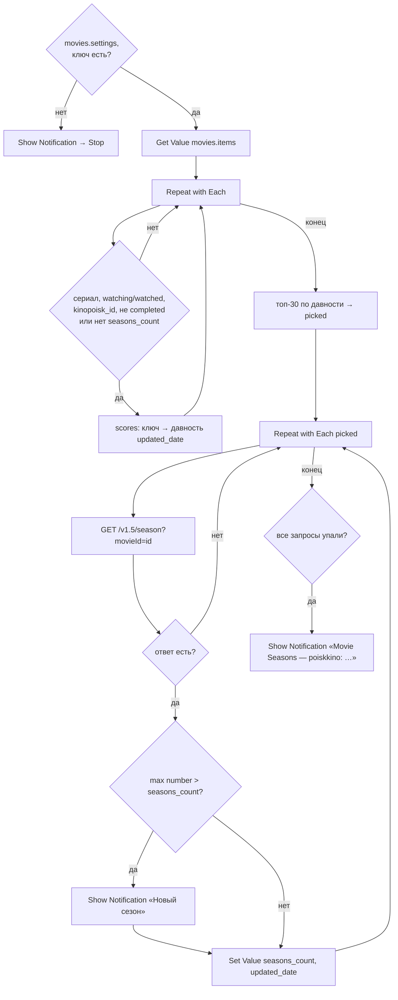

# Movie Seasons

## Назначение

Раз в неделю проверяет сериалы из базы и шлёт уведомление о новом сезоне.

## Вход / Выход

Вход: нет (запуск автоматизацией). Выход: уведомления; обновлённые записи.

## Автоматизация

Shortcuts → Automation → **+** → **Time of Day**: 19:00, Repeat **Weekly**, Sunday → **Run Immediately** (выкл. Notify When Run по желанию) → действие **Run Shortcut** «Movie Seasons».

## Схема

## Шаги

Плоский список действий для сборки в редакторе — [actions.md](actions.md).

1. **Get Value** `movies.settings` → `settings`. Пусто → **Show Notification** «Movie Seasons: нет movies.settings — см. README, Установка» → **Stop This Shortcut**.
2. `settings.poiskkino_api_key` → `apiKey`. Пусто → **Show Notification** «Movie Seasons: нет ключа poiskkino» → **Stop This Shortcut** (автоматизация в фоне — без уведомления ты бы не узнал).
3. **Get Value** `movies.items` → `items` (пусто → **Stop This Shortcut**). **Number** 0 → `okCount`, `errCount`; `lastErr` пусто; `now` = Current Date (ISO 8601).
4. **Repeat with Each** значений `items` — отбор в Dictionary `scores` (ключ → секунды с `updated_date`; нет даты → 999999999), если выполнено всё:
   - `type` ∈ {`tv_show`, `animated_series`, `anime`};
   - `status` ∈ {`watching`, `watched`};
   - `kinopoisk_id` has any value;
   - `release_status` ≠ `completed` **или** `seasons_count` does not have any value.
5. [Топ без сортировки](../data.md#топ-без-сортировки) по `scores`, N = 30 → `picked` — первыми самые давно обновлённые. Лимит 30 запросов соблюдается сам.
6. **Repeat with Each** `picked` (`rec` = запись, `oldCount` = `seasons_count`):
   1. **Get Contents of URL** `https://api.poiskkino.dev/v1.5/season?movieId=<kinopoisk_id>&limit=50&selectFields=number&selectFields=episodesCount`, Header `X-API-KEY: apiKey` → `m`. (В `movie/{id}` поле `seasonsInfo` обычно `null` — проверено 2026-10-23, поэтому отдельный эндпоинт.)
   2. **If** `m.statusCode` есть (ошибка API) → `errCount` + 1, `lastErr` = `<statusCode> <message>`; с записью ничего не делать. **If** `m.docs` пуст (сезонов нет) → ничего. Иначе `okCount` + 1 и шаги 3–5.
   3. Очистить `nums`. **Repeat with Each** `m.docs` → `number` > 0 (0 — спецвыпуски) → **Add to Variable** `nums`. `newCount` = **Calculate Statistics** Maximum `nums` (`nums` пуст — только спецвыпуски → с записью ничего). Анонсированный сезон приходит с `episodesCount` 1 и без `airDate` — считается, уведомление придёт при анонсе.
   4. **If** `oldCount` есть и `newCount` > `oldCount` → **Show Notification** «Новый сезон: title_ru — сезон newCount».
   5. **If** `oldCount` пуст или `newCount` ≠ `oldCount` → **Set Value** `movies.items.<key>.seasons_count` = `newCount`, `movies.items.<key>.updated_date` = `now`.

7. После цикла: `errCount` > 0 **и** `okCount` = 0 → **Show Notification** «Movie Seasons — poiskkino: `lastErr`» (`lastErr` пуст → «нет ответа»; все запросы упали — ключ или лимит). `errCount` > 0 и `okCount` > 0 → тихо (разовый сбой, проверится через неделю).

## Промпты ИИ

Нет.

## Data Jar

Читает: `movies.items`, `movies.settings`. Пишет: `movies.items.<key>.seasons_count`, `.updated_date`.

## Расход запросов poiskkino

1 на подходящий сериал, максимум 30 за запуск (≈ 30 в неделю из 200/сутки).

## Заметки / ограничения

- Первый запуск для сериала без `seasons_count` только заполняет поле, без уведомления.
- `release_status` у poiskkino обычно `null` (проверено) — фильтр «не completed» почти никого не отсекает, проверяются все сериалы watching/watched; топ-30 спасает. `release_status` = `completed` и `seasons_count` есть → сериал больше не проверяется. Если сериал «воскрес» — «Обновить данные» в карточке.
- Ротация: при >30 подходящих сериалах за запуск проверяются 30 самых давно обновлённых (`updated_date`); проверенный с изменением получает свежую дату и уходит в конец очереди, без изменений — `updated_date` не меняется, остаётся в начале.
- Автоматизация Time of Day с Run Immediately работает без подтверждения, но телефон должен быть разблокирован хотя бы раз после перезагрузки (Data Jar).
