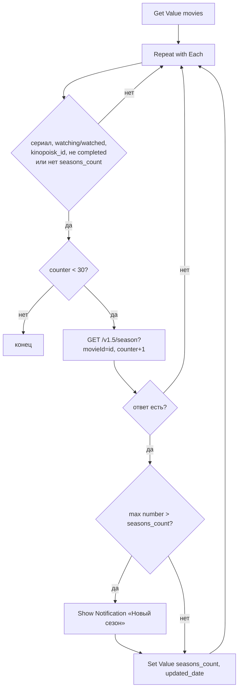

# Movie Seasons

## Назначение

Раз в неделю проверяет сериалы из базы и шлёт уведомление о новом сезоне.

## Вход / Выход

Вход: нет (запуск автоматизацией). Выход: уведомления; обновлённые записи.

## Автоматизация

Shortcuts → Automation → **+** → **Time of Day**: 19:00, Repeat **Weekly**, Sunday → **Run Immediately** (выкл. Notify When Run по желанию) → действие **Run Shortcut** «Movie Seasons».

## Схема

## Шаги

Плоский список действий для сборки в редакторе — [actions.md](actions.md).

1. **Get Value** `movies.settings.poiskkino_api_key` → `apiKey`. Пусто → **Show Notification** «Movie Seasons: нет ключа poiskkino» → **Stop This Shortcut** (автоматизация в фоне — без уведомления ты бы не узнал).
2. **Get Value** `movies.items` → All Values → `db`. **Number** 0 → `counter`, `okCount`, `errCount`; `lastErr` пусто.
3. **Repeat with Each** `db`:
   1. Пропустить (If… Otherwise пусто), если не выполнено всё:
      - `type` ∈ {`tv_show`, `animated_series`, `anime`};
      - `status` ∈ {`watching`, `watched`};
      - `kinopoisk_id` has any value;
      - `release_status` ≠ `completed` **или** `seasons_count` does not have any value.
   2. **If** `counter` ≥ 30 → ничего (Repeat with Each нельзя прервать; оставшиеся проходят вхолостую). **Otherwise** → шаги 3–7.
   3. **Get Contents of URL** `https://api.poiskkino.dev/v1.5/season?movieId=<kinopoisk_id>&limit=50&selectFields=number&selectFields=episodesCount`, Header `X-API-KEY: apiKey` → `m`. **Calculate** `counter + 1`. (В `movie/{id}` поле `seasonsInfo` обычно `null` — проверено 2026-10-23, поэтому отдельный эндпоинт.)
   4. **If** `m.statusCode` есть (ошибка API) → `errCount` + 1, `lastErr` = `<statusCode> <message>`; с записью ничего не делать. **If** `m.docs` пуст (сезонов нет) → ничего. Иначе `okCount` + 1 и шаги 5–7.
   5. Очистить `nums`. **Repeat with Each** `m.docs` → `number` > 0 (0 — спецвыпуски) → **Add to Variable** `nums`. `newCount` = **Calculate Statistics** Maximum `nums` (`nums` пуст — только спецвыпуски → с записью ничего). Анонсированный сезон приходит с `episodesCount` 1 и без `airDate` — считается, уведомление придёт при анонсе.
   6. **If** `seasons_count` есть и `newCount` > `seasons_count` → **Show Notification** «Новый сезон: title_ru — сезон newCount».
   7. **If** `newCount` ≠ `seasons_count` → **Set Value** `movies.items.<key>.seasons_count` = `newCount`, `movies.items.<key>.updated_date` = Current Date.

4. После цикла: `errCount` > 0 **и** `okCount` = 0 → **Show Notification** «Movie Seasons: poiskkino `lastErr`» (все запросы упали — ключ или лимит). `errCount` > 0 и `okCount` > 0 → тихо (разовый сбой, проверится через неделю).

## Промпты ИИ

Нет.

## Data Jar

Читает: `movies.items`, `movies.settings.poiskkino_api_key`. Пишет: `movies.items.<key>.seasons_count`, `.updated_date`.

## Расход запросов poiskkino

1 на подходящий сериал, максимум 30 за запуск (≈ 30 в неделю из 200/сутки).

## Заметки / ограничения

- Первый запуск для сериала без `seasons_count` только заполняет поле, без уведомления.
- `release_status` у poiskkino обычно `null` (проверено) — фильтр «не completed» почти никого не отсекает, проверяются все сериалы watching/watched; лимит 30 спасает. `release_status` = `completed` и `seasons_count` есть → сериал больше не проверяется. Если сериал «воскрес» — «Обновить данные» в карточке.
- Порядок обхода — порядок словаря; при >30 подходящих сериалов дальние не проверяются. Ротация: перед циклом [топ без сортировки](../data.md#топ-без-сортировки) по «давности» (`updated_date` → секунды до Current Date), N = 30 — первыми проверяются самые давно обновлённые.
- Автоматизация Time of Day с Run Immediately работает без подтверждения, но телефон должен быть разблокирован хотя бы раз после перезагрузки (Data Jar).
