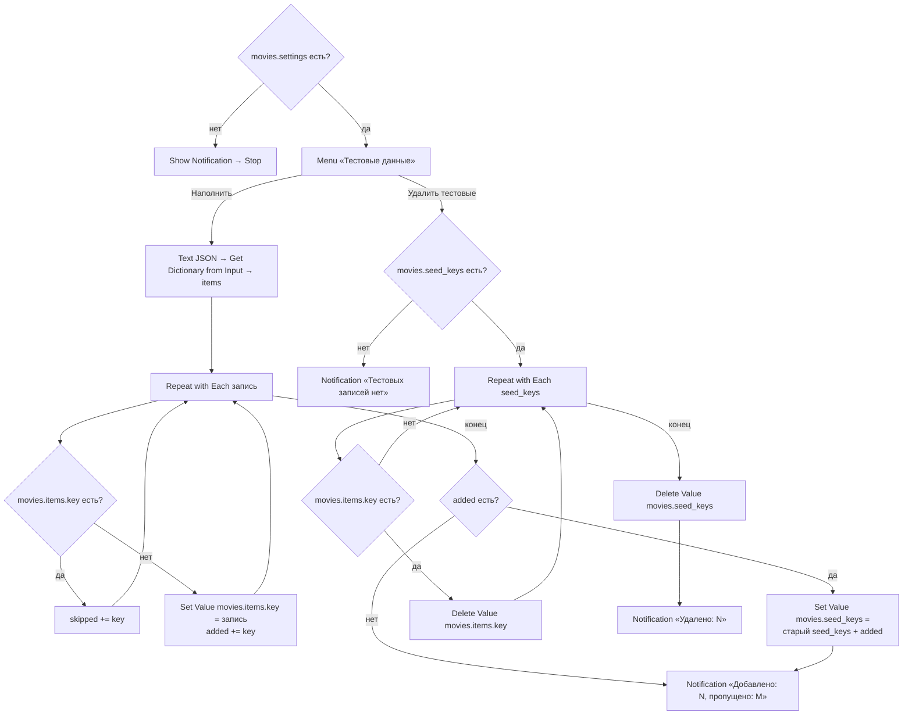

# Movie Seed (тест, потом удалить)

> **Временный шорткат.** Нужен только для быстрого наполнения базы перед [тестами](../TESTING.md). После тестов: «Удалить тестовые» → удалить шорткат из «Команд» и папку `movies/seed/`, убрать строку `movies.seed_keys` из [data.md](../data.md) и упоминания в TESTING.md. В таблицу шорткатов [README](../README.md) не входит.

## Назначение

Наполнить Data Jar 18 тестовыми записями (зашиты в шорткат, 0 запросов poiskkino) и потом удалить ровно их.

## Вход / Выход

Вход: нет. Выход: уведомление «Добавлено: N, пропущено: M» / «Удалено: N».

## Схема

## Шаги

Плоский список действий — [actions.md](actions.md).

1. **Get Value** `movies.settings` → `settings`. Пусто → **Show Notification** «Нет movies.settings — см. README, Установка» → **Stop This Shortcut**. Настройки шорткат не создаёт и не читает дальше.
2. **Choose from Menu** «Тестовые данные»: Наполнить / Удалить тестовые.
3. **Наполнить**:
   1. **Text** — JSON `{"items":[…]}` со всеми записями → **Get Dictionary from Input** → **Get Dictionary Value** `items` → `seed`.
   2. **Repeat with Each** `seed`: `k` = `key` записи. **Check if Value Exists** `movies.items.<k>` → есть → **Add to Variable** `skipped` (живую запись не перезаписываем, в `seed_keys` не попадает). Нет → **Set Value** `movies.items.<k>` = запись целиком, **Add to Variable** `added`. `movies.items` при этом создаётся сам (вложенный путь Data Jar).
   3. **If** `added` есть: старый `movies.seed_keys` (если есть) + `added` → `allKeys` → **Set Value** `movies.seed_keys`. Повторный запуск не теряет ключи прошлого.
   4. **Show Notification** «Добавлено: Count `added`, пропущено: Count `skipped`».
4. **Удалить тестовые**:
   1. **Check if Value Exists** `movies.seed_keys` → нет → «Тестовых записей нет».
   2. **Repeat with Each** `movies.seed_keys`: `k` (Text) → **Check if Value Exists** `movies.items.<k>` → есть → **Delete Value** `movies.items.<k>`, **Add to Variable** `deleted`.
   3. **Delete Value** `movies.seed_keys` → **Show Notification** «Удалено: Count `deleted`».
   4. Удаляются только ключи из `seed_keys`. Тестовая запись, которую ты успел изменить (оценка, статус), тоже удалится — она всё равно тестовая.

## Тестовые записи

Поля — по [data.md](../data.md#запись-moviesitemskey). `kinopoisk_id` и `imdb_id` — **по памяти, не проверены**: если карточка ведёт не туда — «Обновить данные» (тянет по id) покажет, что id чужой; тогда запись просто удалить. `poster_url` — старый формат `st.kp.yandex.net/images/film_big/<kp>.jpg`, может не открыться («Обновить данные» перепишет). Рейтинги, длительность, даты — приблизительные. `added_date` — сентябрь 2026, по порядку.

| Ключ | Тайтл | Что покрывает |
|---|---|---|
| `tt0111161` | Побег из Шоушенка (1994) | watched ★10, заметка, тег, **один жанр — строкой** `"Drama"` |
| `tt0816692` | Интерстеллар (2014) | watched ★9, заметка |
| `tt0133093` | Матрица (1999) | watched **без оценки**, `origin` = `recommendation` |
| `tt0118767` | Брат (1997) | watched ★8, отечественный |
| `kp-42664` | Иван Васильевич меняет профессию (1973) | ключ **`kp-`**, нет `imdb_id`, только `ratings.kp`, ★9, заметка, тег |
| `tt0903747` | Во все тяжкие (2008) | сериал watched ★10, `seasons_count` 5, `completed`, есть `seasons_checked` |
| `tt0944947` | Игра престолов (2011) | сериал **dropped** ★6, заметка, `completed`, `seasons_checked` |
| `tt4574334` | Очень странные дела (2016) | сериал **watching**, `seasons_count` 4 (занижено — Seasons должен прислать «Новый сезон … — сезон 5»), нет `release_status` и `seasons_checked` (проверяется первым) |
| `tt10466872` | Разделение (2022) | сериал watching, `filming`, старый `seasons_checked`, recommendation. Если уже есть в живой базе — пропустится |
| `tt0910970` | ВАЛЛ·И (2008) | тип **animation**, ★8, два тега |
| `tt0245429` | Унесённые призраками (2001) | тип **anime**, ★10, заметка |
| `tt2861424` | Рик и Морти (2013) | тип **animated_series**, unwatched, recommendation |
| `tt0120338` | Титаник (1997) | **dismissed** (Скрытые), recommendation |
| `tt15239678` | Дюна: Часть вторая (2024) | unwatched, тег — кандидат «Мой список» |
| `ai-the-batman-part-ii-2027` | Бэтмен 2 (2027) | **будущая премьера** 2027-10-01, unwatched, `source` = `ai`, нет id/рейтингов/постера |
| `ai-my-octopus-teacher-2020` | Мой учитель — осьминог (2020) | тип **documentary**, **нет `premiere_date`**, нет id/рейтингов, ★7, жанр строкой |
| `ai-pinocchio-2022` | Пиноккио (2022) | пара с меткой «Пиноккио / Pinocchio (2022)» — ремейк Disney |
| `ai-guillermo-del-toros-pinocchio-2022` | Пиноккио (2022) | вторая в паре (дель Торо, animation): в Rate «Несмотренные»/«Все» вторая метка с ` · key`. Ключ от исходного англ. названия ИИ, `title_en` потом стал `Pinocchio` — ключ не меняется |

Итого: 9 оценённых (≥ 3 для вкуса), все 5 статусов, все 6 типов, 5 сериалов (2 с `seasons_checked`, 3 без), разные годы 1973–2027 и жанры.

## Data Jar

Читает: `movies.settings` (только проверка), `movies.items.<key>` (Check if Value Exists), `movies.seed_keys`. Пишет: `movies.items.<key>` (только отсутствующие), `movies.seed_keys` ([data.md](../data.md#корень-movies), временный). Удаляет: `movies.items.<key>` из `seed_keys`, сам `movies.seed_keys`.

## Расход запросов poiskkino

0.

## Заметки / ограничения

- Не проверено на iPhone: Get Dictionary from Input на большом JSON с вложенными словарями; Set Value записи при отсутствующем `movies.items` (ожидается автосоздание, как у других вложенных путей).
- Записи — словари из JSON, поэтому `genres`/`tags` из двух и более — настоящие списки, из одного — строка (как пишет Data Jar в жизни).
- Записи не проходят Movie Lookup: `description` и названия — вручную.
