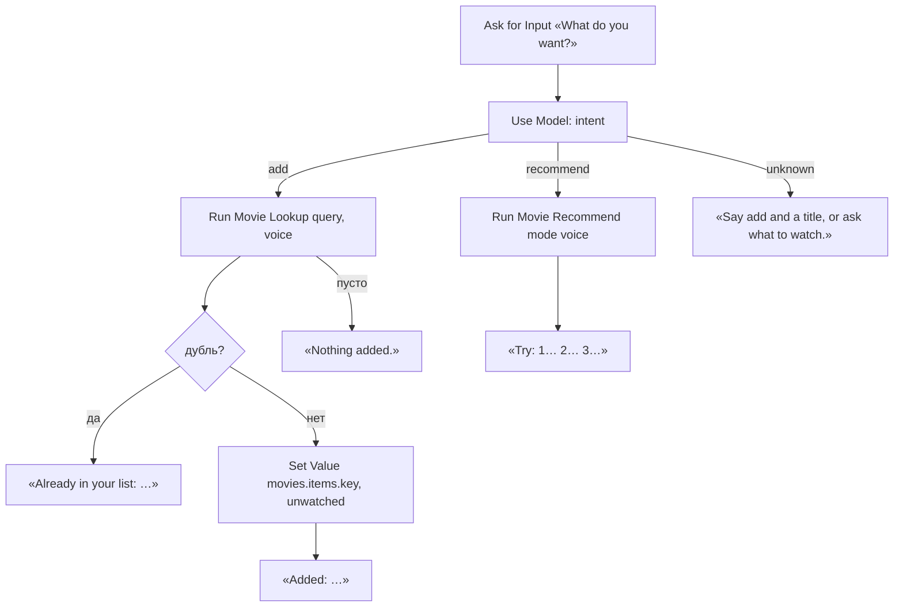

# Movies (голосовой вход)

## Назначение

**Дополнительный** путь: основной функционал — на экране iPhone (Add, Rate, Card, Recommend). Movies — быстрый вход для Siri одной фразой, без экрана (AirPods, CarPlay, HomePod; iPhone должен быть **разблокирован** — с заблокированного Siri шорткат не запускает, проверено). Умеет только два действия, остальное — на экране. «Hey Siri, Movies» → Siri спрашивает «What do you want?» → фраза → ИИ разбирает намерение:

| Намерение | Пример фразы | Результат (Siri читает вслух) |
|---|---|---|
| `add` | «add Dune Prophecy», «add the series Severance» | «Added: Dune: Prophecy, 2024, series, IMDb 7.3.» |
| `recommend` | «what to watch tonight», «something light, a movie» | «Try: 1. … 2. … 3. …» |

Оценка, статус, карточка, ссылки, чат — только на экране (Rate / Card).

## Вход / Выход

Вход: нет (или Text — тогда без Ask for Input). Выход: **Stop and Output** Text — Siri произносит его в конце.

## Правила голосового пути

- Ничего, что требует экрана или открывает приложение: без Show Web Page, Quick Look, Follow Up, Add New Event, Share. Если шорткат открывает приложение, Siri просит разблокировать ([Apple](https://support.apple.com/guide/shortcuts/apd07c25bb38/ios)).
- Все тексты, которые Siri произносит, — **по-английски** (Siri на английском; русский текст она читает плохо). Названия — `title_en`.
- Вопросы — только когда без них нельзя: несколько вариантов тайтла → Siri зачитывает их, выбор голосом.
- Ошибки — тоже в выходной текст (уведомление голосом не прочитается).

## Схема



## Шаги

1. **Get Value** `movies.settings` → `settings`. [Проверка настроек](../data.md#ошибки), но вместо уведомления — **Stop and Output** «Movies settings are missing. Open the Shortcuts app.».
2. **If** Shortcut Input has any value → `phrase` = Shortcut Input. Otherwise → **Ask for Input** (Text, «What do you want? Add a title, or ask what to watch.») → `phrase`.
3. `ai_enabled` = `false` → без ИИ: **Match Text** `^add\s+(.+)` (без учёта регистра) → есть → `intent` = `add`, `title` = группа 1; нет → `intent` = `recommend`, `mood` пуст, `types` пуст. Иначе **Use Model** (Private Cloud Compute, Output: Dictionary, [запасной путь](../data.md#ответ-ии-use-model)) — промпт «Намерение» → `intent`, `title`, `mood`, `types`. ИИ не ответил → **Stop and Output** «Sorry, I didn't get that.».
4. **intent = add**:
   1. **Run Shortcut** Movie Lookup, Input **Dictionary** `{query: title, voice: true}` → `rec`. Пусто → **Stop and Output** «Nothing added. Check the phone for details.» (причина — в уведомлении Lookup: не найдено, ошибка API, отмена).
   2. Дубль — как в [Movie Add](../add/README.md#шаги), шаги 5–6. Есть → **Stop and Output** «Already in your list: title_en (year).».
   3. **Set Dictionary Value** в `rec`: `status` = `unwatched`, `origin` = `manual`, `added_date`, `updated_date` = Current Date, `tags` = [], `note` = "". **Set Value** `movies.items.<key>` = `rec`.
   4. **Text**: `Added: <title_en>, <year>, <метка типа англ.>` + `, IMDb <x>` (если есть) + `. Not found on Kinopoisk, saved from AI data.` (если `source` = `ai`) + `. Premieres on <premiere_date>.` (если в будущем) → **Stop and Output**.
5. **intent = recommend**: **Run Shortcut** Movie Recommend, Input **Dictionary** `{mode: "voice", mood, types}` → текст → **Stop and Output**. Текст пуст (Recommend остановился сам) → **Stop and Output** «No recommendations. Check the phone for details.».
6. **intent = unknown** → **Stop and Output** «Say add and a title, or ask what to watch.».

Метки типов для речи: movie → movie, tv_show → series, animation → animated film, animated_series → animated series, anime → anime, documentary → documentary.

## Промпты ИИ

Намерение (Output: Dictionary). Вставка `[phrase]`.

```
The user spoke a voice command to a movie list app. Speech recognition is in English, so Russian titles may come out as a rough English transcription (for example "brat two" may mean the Russian film "Брат 2").

Command: "[phrase]"

Return a dictionary with:
- "intent": exactly one of: add, recommend, unknown
- "title": for add — the title the user wants to add, cleaned of command words (string); otherwise empty
- "mood": for recommend — the mood or wish in a few English words, e.g. "light comedy", "something tense" (string); empty if none
- "types": for recommend — list of requested types from: movie, tv_show, animation, animated_series, anime, documentary; empty list if not specified
```

## Data Jar

Читает: `movies.settings`, `movies.items` (дубли). Пишет: `movies.items.<key>` при `add`.

## Расход запросов poiskkino

`add` — как Movie Lookup (~2). `recommend` — 0.

## Заметки / ограничения

- Имя шортката **Movies** — это фраза для Siri. Переименуешь — фраза меняется.
- Русские названия при английской Siri распознаются плохо. Надёжнее называть английское название; промпт Lookup и «Намерение» учитывают кривую транскрипцию.
- Apple Watch не поддерживается: Use Model на watchOS нет.
- С **заблокированного** iPhone Siri не реагирует (мини-тест 7, 2026-10-24) — разблокировать телефон перед «Hey Siri, Movies».
